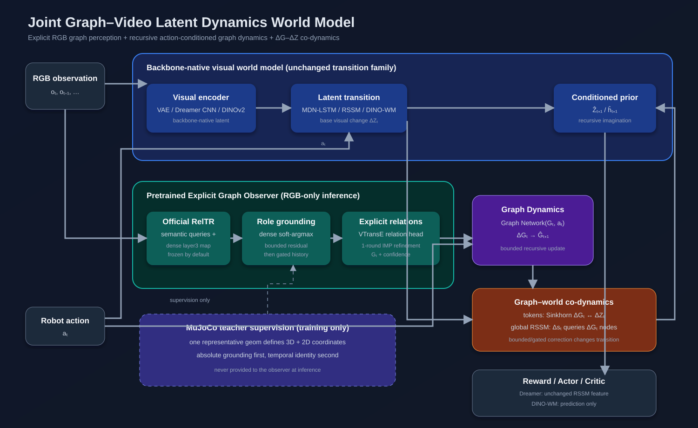

# Joint Graph–Video Latent Dynamics World Model

[](LICENSE)

JointGV is a research implementation of a pluggable Graph Dynamics module for
visual world models. A backbone adapter selects both the native visual
representation and latent transition while the graph plugin, environment data,
planner, and evaluation path stay shared.

Four JointGV backbone configurations are currently runnable:

- `david_ha`: Gaussian spatial VAE + factorized World Models (2018) MDN-LSTM;
- `dreamerv3`: native deterministic CNN spatial tokens + the pinned
  DreamerV3 discrete RSSM;
- `dreamerv3_vae`: JointGV Gaussian-VAE tokens + the same DreamerV3 RSSM.
- `dino_wm`: the pinned official DINOv2 frozen patch-token encoder (via
  `benchmark/dino_wm`) + a JointGV causal Transformer that predicts the next
  frame's patch tokens, in the same offline world-model-only protocol as
  `david_ha`.

The two DreamerV3 adapters share identical RSSM, graph, reward, continuation,
and online actor--critic modules; only their visual representation differs. The historical
compact implementation and its compatibility aliases have been removed.

`dino_wm` follows the offline `train.py` protocol (like `david_ha`), not
`train_online_dmc.py`: the official DINO-WM is a patch-feature predictor rather
than this repo's online actor-critic. The frozen DINOv2 encoder and its causal
predictor are adopted here. The RM65-B pre-study uses its learned reward head
for fixed-horizon reward-CEM; generic goal-image CEM remains available for
tasks whose goal really is a complete target image.

> **Current primary protocol:** `train_online_dmc.py` follows the pinned
> Burchim DreamerV3 DMC online collection, replay, imagination, actor, critic,
> and evaluation schedule. `train.py`, `collect_dmc.py`, and CEM are retained
> as the tagged `v0.3.0-offline` research pipeline and for Explicit Graph
> Observer pretraining; they are no longer the primary control comparison.

## Experiment Choices

There are **four backbone configurations and two graph settings, for eight
experiment configurations**. Graph conditioning is enabled by default; append
`--disable-graph-conditioning` for the matched backbone-only baseline.

| # | Backbone | Graph | CLI | Status |
|---:|---|---|---|---|
| 1 | David Ha World Models 2018 | Off | `--backbone david_ha --disable-graph-conditioning` | Runnable |
| 2 | David Ha World Models 2018 | JointGV | `--backbone david_ha` | Runnable |
| 3 | DreamerV3 native vision | Off | `--backbone dreamerv3 --disable-graph-conditioning` | Runnable |
| 4 | DreamerV3 native vision | JointGV | `--backbone dreamerv3` | Runnable |
| 5 | DreamerV3 + JointGV VisualVAE | Off | `--backbone dreamerv3_vae --disable-graph-conditioning` | Runnable |
| 6 | DreamerV3 + JointGV VisualVAE | JointGV | `--backbone dreamerv3_vae` | Runnable |
| 7 | DINO-WM frozen DINOv2 + causal patch predictor | Off | `--backbone dino_wm --disable-graph-conditioning` | Runnable |
| 8 | DINO-WM frozen DINOv2 + causal patch predictor | JointGV | `--backbone dino_wm` | Runnable |

DreamerV3 graph-off/on control experiments run through
`train_online_dmc.py`. The selected DreamerV3 encoder, RSSM, decoder, losses,
online replay, and actor--critic protocol remain fixed between each matched
pair. See
[the backbone-alignment contract](docs/DREAMERV3_ALIGNMENT.md) for the audited
version differences and acceptance criteria.

## Architecture



```text
RGB_t -------- backbone-native encoder -------- latent state/tokens          |
                                                     |                       |
            (latent_t, a_t) -- MDN-LSTM / RSSM / DINO-WM -- latent change --+
                                                                             |
RGB_t -------- official RelTR -- robot role binding -- explicit G_t          |
                                                     |                       |
                         (G_t, a_t) -- Graph Dynamics -- Delta G ------------+
                                                     |                       |
           token set: Sinkhorn Delta G <-> Delta Z                           |
        global RSSM: normalized Delta s queries Delta G node attention ------+
                                                                         |
                                             bounded/gated correction    |
                                                                         v
                              image / reward / continuation / actor--critic
```

For the MDN-LSTM and DINO-WM, the visual representation contains a
genuine token set, so full Sinkhorn alignment is used. For the MDN-LSTM, correction is
applied to every Gaussian component mean
while mixture weights and standard deviations remain unchanged. DINO-WM's causal patch
predictor is deterministic and unquantized, so correction is added directly
to the predicted continuous patch-token embeddings before they feed the next
step and the diagnostic decoder. DreamerV3 has one global
RSSM state change rather than a natural token set: normalized `Delta s` queries
the valid `Delta G` nodes, and their attention-pooled context produces a
bounded, gated correction to the prior deterministic state before its
categorical state is recomputed. Therefore
the graph branch is not merely an auxiliary loss; it changes recursive latent
dynamics.

The reportable graph path uses an independently pretrained
`ExplicitGraphObserver`. It imports the pinned official RelTR submodule and
loads its Visual Genome ResNet-50 + relation-transformer checkpoint without
reimplementing RelTR. Persistent robot-role binding, a compact VTransE-style
physical relation head, one node-edge IMP refinement round, and temporal
recurrence are the JointGV-specific adapter. MuJoCo physical state and
camera-aligned segmentation centroids are teacher targets only; inference
remains RGB-only.
The original `LatentGraphBuilder` remains available as `--graph-observer proxy`
for compatibility and early diagnostics, but it is not the intended explicit
graph experiment.

## Code Structure

```text
script/jointgv/
  jointgv/
    blocks/
      visual_vae.py       Gaussian VAE visual codec
      visual_codec.py     common visual-codec interface
      dino_visual_codec.py frozen DINOv2 patch-token codec (DINO-WM adapter)
      graph_builder.py    replaceable Proxy Scene Graph Builder
      explicit_graph_observer.py  official RelTR + physical-role adapter
      graph_dynamics.py   action-conditioned Graph Network
      graph_plugin.py     token Sinkhorn or global alignment and correction
    backbones/
      adapters.py         visual-representation/transition routing
      base.py             common transition interface
      david_ha_2018.py    MDN-LSTM backbone
      dreamerv3.py        pinned DreamerV3 RSSM, native/VAE adapters
      dino_wm.py          causal patch-token predictor (DINO-WM adapter)
    world_model.py        composes encoder + backbone + graph plugin
    losses.py             common visual/graph/control objectives
    rollout_metrics.py    motion MSE / SSIM / joint-position rollout metrics
    envs/                 non-DMC simulations (RM65-B robot cart-pole and the
                          retained pendulum/reaching real-robot pre-study)
    online.py             Burchim-aligned replay, DMC, actor/critic utilities
    planning.py           goal-image and learned-reward CEM-MPC (DINO-WM)
    data.py               fixed-length episode windows
  train.py                offline world-model trainer (DINO-WM, DreamerV3 offline)
  train_online_dmc.py     online world-model/actor/critic trainer (Burchim protocol)
  train_reward_heads.py   per-track reward heads for reward-CEM (after train.py)
  utils/
    collect_dmc.py        render and collect DMC/MuJoCo episodes
  pretrain/
    pretrain_graph_observer.py  pretrain RGB-to-explicit-graph perception
    pretrain_dino_decoder.py    pretrain the DINO-WM projection + diagnostic decoder
  evaluation/
    evaluate_ablation.py  test-set rollout tables (joint px, SSIM, LPIPS, MSE)
    evaluate_rollout.py   one-episode open-loop rollout comparison (.npz)
    evaluate_online_dmc.py  actor-based DMC return and RGB evaluation
    evaluate_planning.py  rm65b visible-target reward MPC: random/base/graph/oracle
    evaluate_cartpole_planning.py  rm65b cart-pole reward-CEM: zero/random/oracle/base/graph
    evaluate_cartpole_lqr.py       rm65b cart-pole privileged LQR controllability check
  viz/
    export_rollout_video.py     labelled GIF from an evaluate_rollout.py .npz
    plot_ablation_curves.py     torch-free plots of evaluate_ablation.py output
    view_episode.py             RGB playback and native MuJoCo replay
    visualize_graph_observer.py synchronized RGB/GT/predicted graph debugger
    visualize_dino_decoder.py   DINO encode/decode reconstruction debugger
    draw_architecture.py        regenerate docs/figures/jointgv_architecture.png
    preview_env.py              GIF + stats of an environment under exploration
    preview_windows.py          grid GIF of stored 64x64 windows from the start, middle and end of episodes
    view_typical_windows.py     cart-pole: plays labelled typical clips one window at a time
  tests/
    check_pose_correction.py    DINO-WM plug-in pre-flight checks (seconds)
    check_dreamer_plugin.py     DreamerV3 plug-in (P) pre-flight checks (seconds)
    check_planner.py            CEM-MPC planner and rm65b goal helper checks
    smoke_test.py               CUDA/gradient/shape check
  tmp/                    scripts the graph plugin does not need: LIBERO
                          tools, VAE / graph-dynamics pretraining,
                          drift diagnostics, legacy CEM evaluation

docs/figures/             architecture diagram
benchmark/                third-party reference implementations, including
                           the official DINO-WM submodule (benchmark/dino_wm)
```

Run every script from the repository root, e.g.
`python script/jointgv/evaluation/evaluate_ablation.py ...`; each one puts
`script/jointgv` on `sys.path` itself.

`model.py` and `mdn_lstm.py` are small compatibility facades for earlier local
experiments; new code should import from `world_model`, `blocks`, or
`backbones`.

## RM65-B Robot Cart-Pole Balance

`--domain rm65b --task cartpole` is a custom RM65-B counterpart of DMC's
Cartpole Balance. DMC already provides `cartpole/balance`, but its actuator is
a one-dimensional slider cart; it does not contain the RM65-B. Here the robot
uses coordinated J2/J3/J5 motion to move a side-mounted passive hinge along a
fixed-height horizontal path while keeping a 300 mm pole upright.

- Scene: the same matte-black board and side camera as the RM65-B pre-study.
  There is no target disk. The pole is thick yellow and its remote endpoint is
  a 70 mm cyan ball so both remain legible in the stored 64x64 frames.
- Mechanics: one unactuated hinge about the camera-plane normal, deliberately
  moderate viscous damping (`0.015 N m s/rad`) and very small Coulomb friction.
  There is no spring or hard stop holding it upright. The 100 mm camera-side offset and
  disabled pole-arm contacts prevent the pole being propped against the robot.
- Action: one normalised horizontal hinge-velocity command. Analytic planar IK
  maps it to safe J2/J3/J5 position targets while keeping hinge height and tool
  pitch fixed. The visible dynamics still contain the complete articulated arm.
- Initial state: every episode uses the same fixed RM65-B joint pose, the same
  hinge position and zero velocity. The pole angle is sampled uniformly over
  `+/-7 deg` (locked 2026-10-02; see the LQR controllability check below:
  larger leans drive the pivot into the end of the 22 cm rail). This is a
  balance task rather than swing-up.
- Episode: at most 20 s, but terminates immediately with zero discount when
  the pole reaches horizontal (`abs(angle) >= 90 deg`). Episode lengths are
  therefore variable and no post-failure frames are collected.
- Reward: one term only,
  `clip(1 - abs(pole_angle) / 90_deg, 0, 1)`. Workspace bounds are physical
  guards, not reward components. Episode return is the accumulated upright
  score before failure or the 20 s time limit.
- Graph: `base`, three arm links, the hinge/pole root and the cyan pole tip,
  with two padding nodes under the existing eight-node protocol.
- Preview exploration uses a privileged noisy stabiliser to exercise balance
  and recovery behaviour. Each collected episode fixes one correction-speed
  ceiling from `0.10/0.18/0.27/0.36/0.45 m/s`; consecutive groups of five
  episodes contain every level once. The gain no longer changes in the middle
  of a recovery, while the complete dataset still covers slow through
  full-speed corrections. It is not a trained or reportable controller and
  must not be compared with JointGV planning results.

Inspect the setting before collecting any dataset or launching training:

```powershell
Set-Location 'E:\Projects\Joint_Graph_Vedio_Latent_Dynamic_World_Model'
conda activate jointgv

# Opens MuJoCo and plays one episode, then exits at failure or after 20 s.
python script/jointgv/viz/view_env.py --domain rm65b --task cartpole `
  --seed 0 --explore --episodes 1
```

For a controlled visual comparison, keep seed 0 fixed and view separate
episodes with 0.10, 0.27 and 0.45 m/s correction-speed ceilings via
`viz/view_env.py --cartpole-speed`.

Do not start collection until the pole length, endpoint visibility, horizontal
travel, damping, camera framing and balance difficulty have been accepted from
this live episode.

After collecting a small pilot, inspect exactly the stored 64x64 input frames
that the world model will receive. The following shows only the first 32
frames, so slow motion cannot be hidden by watching a much longer native
MuJoCo episode:

```powershell
python script/jointgv/viz/view_episode.py `
  data/rm65b_cartpole_train_v3/rm65b_cartpole_00000.npz `
  --start-frame 0 --frames 32 --fps 4 --scale 8
```

### Current Cart-Pole dataset and overnight training protocol

The retained v2 training subset contains the first 400 deterministically
collected episodes (`data/rm65b_cartpole_train_v2_400`): 46,051 transitions,
2,292 Observer windows at length/stride 32/16, and 5,182 world-model windows at
length/stride 16/8. Validation and test retain their separate 160-episode
splits and disjoint seeds. The 400 files are hard links into the retained
800-episode source collection, so this subset adds no duplicate payload and
does not alter the source data. These existing v2 files were collected under
the earlier `+/-3 deg` initialization and are not retroactively changed by the
current `+/-7 deg` environment. Any recollection must use new v3 data/run
directories so the two protocols cannot be silently mixed.

Do not confuse the three independent dimensions in this protocol. Stored RGB
observations are 64x64, both frozen RelTR and DINOv2 receive images resized to
224x224, and native `dinov2_vits14` patch tokens have width 384. The latest
completed native-384 RM65-B pendulum run
(`rm65b_pendulum_dino_wm_P_native384_h16_b16/run_config.json`) establishes the
24 GB world-model profile used here: model batch 16, 16-frame training windows,
384-dimensional tokens, DINO/RelTR image size 224, RelTR extraction chunk 16,
gradient checkpointing, and 32-frame rollout evaluation. The standalone
Observer uses model batch 8 and RelTR extraction chunk 64 to improve frozen
feature-extraction throughput without reducing the RelTR image resolution.
Because Cart-Pole terminates at horizontal failure, ordinary validation uses
all 160 validation episodes while the fixed H=32/context=3 rollout metric is
defined only for the 146 episodes with at least 35 transitions. The trainer
prints and skips the 14 shorter episodes for that rollout metric only; it does
not remove them from training or ordinary validation.

Cart-Pole rollout evaluation reports the generic image/motion/SSIM/all-node
metrics plus five task-specific structural errors: pole-tip pixels, hinge
pixels, pole-vector pixels, wrapped pole-angle MAE in degrees, and wrapped
pole angular-change error in degrees. Training logs prefix means at H=8/16/32.
`evaluation/evaluate_ablation.py --reference backbone` additionally reports,
for every metric and horizon, the paired fraction of identical episode
windows on which corrected prediction beats the backbone; ties and the valid
window count are stored in `metrics.json`.

Run the three stages in order. Use a fresh output directory for every attempt;
the trainers deliberately refuse to overwrite an existing run.

```powershell
python script/jointgv/pretrain/pretrain_graph_observer.py `
  --data data/rm65b_cartpole_train_v2_400 `
  --validation-data data/rm65b_cartpole_val_v2 `
  --output runs/rm65b_cartpole_reltr_observer_v2_400_b8 `
  --epochs 30 --lr 3e-4 `
  --batch-size 8 `
  --sequence-length 32 --stride 16 `
  --graph-nodes 8 --node-dim 64 `
  --backbone reltr_resnet50 `
  --reltr-checkpoint Models/reltr/checkpoint0149.pth `
  --reltr-image-size 224 --reltr-batch-size 64 `
  --temporal-max-correction 0.25 `
  --max-position-residual 0.25 `
  --identity-weight 0.05 --motion-weight 1.0 `
  --link-pixel-weight 2.0 --end-effector-pixel-weight 5.0 `
  --grounding-epochs 10 --temporal-warmup-epochs 10 `
  --recursive-validation-every 5 `
  --recursive-validation-episodes 0 `
  --recursive-frame-batch-size 64 `
  --workers 0

python script/jointgv/pretrain/pretrain_dino_decoder.py `
  --data data/rm65b_cartpole_train_v2_400 `
  --validation-data data/rm65b_cartpole_val_v2 `
  --output runs/rm65b_cartpole_dino_decoder_native384_h16_v2_400_b16 `
  --epochs 20 --batch-size 16 `
  --sequence-length 16 --stride 16 `
  --token-dim 384 `
  --dino-model dinov2_vits14 --dino-image-size 224 `
  --lr 3e-4 --workers 0

python script/jointgv/train.py `
  --data data/rm65b_cartpole_train_v2_400 `
  --validation-data data/rm65b_cartpole_val_v2 `
  --output runs/rm65b_cartpole_dino_wm_P_native384_h16_b16_v2_400 `
  --plugin-correction --seed 67280421310721 `
  --backbone dino_wm --token-dim 384 `
  --dino-model dinov2_vits14 --dino-image-size 224 `
  --dino-predictor-depth 6 --dino-predictor-heads 16 `
  --dino-mlp-ratio 5.333333333333333 --dino-dropout 0.1 `
  --dino-max-frames 16 --dino-gradient-checkpointing `
  --visual-checkpoint runs/rm65b_cartpole_dino_decoder_native384_h16_v2_400_b16/best.pt `
  --freeze-visual `
  --graph-observer explicit `
  --graph-observer-checkpoint runs/rm65b_cartpole_reltr_observer_v2_400_b8/best_long_rollout.pt `
  --reltr-checkpoint Models/reltr/checkpoint0149.pth `
  --reltr-image-size 224 --reltr-batch-size 16 `
  --epochs 100 --batch-size 16 `
  --sequence-length 16 --stride 8 --lr 1e-4 `
  --motion-weighted-transition-loss `
  --graph-warmup-epochs 10 --ot-warmup-epochs 20 `
  --ot-weight 0.1 --ot-variance-weight 0.1 `
  --graph-history 4 --graph-embedding-weight 1.0 `
  --graph-multistep-horizon 8 --graph-multistep-weight 1.0 `
  --separate-graph-grad-clip `
  --graph-pose-correction --graph-pose-sigma 0.15 `
  --graph-position-weight 1.0 --max-graph-correction 1.0 `
  --correction-unroll-horizon 8 --correction-unroll-weight 1.0 `
  --rollout-eval-start 10 --rollout-eval-every 5 `
  --rollout-horizon 32 --rollout-context-frames 3 `
  --rollout-observer-checkpoint runs/rm65b_cartpole_reltr_observer_v2_400_b8/best_long_rollout.pt `
  --workers 0
```

After training has stopped, compare backbone and corrected rollout from the
same checkpoint. `--windows-per-episode 0` uses every eligible non-overlapping
window instead of only the unusually static first window of each episode:

```powershell
python script/jointgv/evaluation/evaluate_ablation.py `
  --model backbone runs/rm65b_cartpole_dino_wm_P_native384_h16_b16_v2_400/latest.pt base `
  --model corrected runs/rm65b_cartpole_dino_wm_P_native384_h16_b16_v2_400/latest.pt graph `
  --reference backbone `
  --data data/rm65b_cartpole_val_v2 `
  --observer-checkpoint runs/rm65b_cartpole_reltr_observer_v2_400_b8/best_long_rollout.pt `
  --horizon 32 --context-frames 3 --windows-per-episode 0 `
  --batch-size 8 --no-lpips --device cuda `
  --output runs/eval/rm65b_cartpole_v2_epoch100_task_metrics
```

The terminal prints H=8/16/32 means, confidence intervals and paired window
win rates. The same values, tie rates, valid counts and per-step curves are
saved in `metrics.json`; no training is performed by this command.

### Cart-Pole reward-CEM control diagnostic

Do not use `evaluation/evaluate_planning.py` for this task: that script is the
visible-target pendulum-transport protocol. Cart-Pole uses
`evaluation/evaluate_cartpole_planning.py`, where success means surviving the
complete fixed interval without reaching horizontal or activating the cart
workspace guard. Its scalar score is the environment's upright reward; it
also reports pole angle/rate and CEM latency.

Fit matched reward heads on backbone-only and graph-corrected imagination from
the same frozen epoch-100 checkpoint. CEM itself is not trained. The heads are
needed because the world model's original reward head saw backbone predictions
during P training, not graph-corrected rollout tokens.

```powershell
python script/jointgv/train_reward_heads.py `
  --track backbone runs/rm65b_cartpole_dino_wm_P_native384_h16_b16_v2_400/latest.pt base `
  --track corrected runs/rm65b_cartpole_dino_wm_P_native384_h16_b16_v2_400/latest.pt graph `
  --data data/rm65b_cartpole_train_v2_400 `
  --validation-data data/rm65b_cartpole_val_v2 `
  --output runs/rm65b_cartpole_reward_heads_v2_epoch100_h16 `
  --context-frames 3 --horizon 16 --history-window 4 `
  --train-stride 8 --validation-stride 8 `
  --rollout-batch 16 --batch-size 256 `
  --epochs 60 --patience 8 --positive-threshold 1.8 `
  --amp --device cuda
```

Then run the in-distribution `+/-3 deg` comparison. All five controllers use
the same seeds. At 25 Hz with `--replan-every 4`, learned CEM has 0.16 s per
replan; `realtime_plan_rate` is the fraction meeting that deadline.

```powershell
python script/jointgv/evaluation/evaluate_cartpole_planning.py `
  --model backbone runs/rm65b_cartpole_dino_wm_P_native384_h16_b16_v2_400/latest.pt base `
  --model corrected runs/rm65b_cartpole_dino_wm_P_native384_h16_b16_v2_400/latest.pt graph `
  --reward-head backbone runs/rm65b_cartpole_reward_heads_v2_epoch100_h16/backbone.pt `
  --reward-head corrected runs/rm65b_cartpole_reward_heads_v2_epoch100_h16/corrected.pt `
  --episodes 5 --seed 30000 --steps 150 --initial-angle-deg 3 `
  --horizon 16 --replan-every 4 `
  --candidates 128 --elites 16 --iterations 3 `
  --oracle-candidates 64 --oracle-elites 8 --oracle-iterations 3 `
  --history-window 4 --chunk-size 64 --amp --device cuda `
  --gif-episodes 2 --output runs/eval/rm65b_cartpole_cem_v2_id3
```

Historical: Oracle alone at `+/-30 deg` (10-01) succeeded in only about 10 %
of episodes. The LQR check below shows why: such leans cannot be recovered
with the current pivot speed and rail. The command is kept for the record.

```powershell
python script/jointgv/evaluation/evaluate_cartpole_planning.py `
  --no-zero --no-random `
  --episodes 5 --seed 31000 --steps 150 --initial-angle-deg 30 `
  --horizon 16 --replan-every 4 `
  --oracle-candidates 64 --oracle-elites 8 --oracle-iterations 3 `
  --device cpu --gif-episodes 2 `
  --output runs/eval/rm65b_cartpole_cem_oracle_ood30
```

Each command writes `metrics.json`, `episodes.csv`, and comparison GIFs while
printing all progress and per-episode results directly in the terminal.

### Cart-Pole physical controllability (privileged LQR)

Before collecting a new dataset at a larger initial lean, check that the robot
can recover it at all with its real limits (0.45 m/s, 6 m/s^2, 22 cm rail).
`evaluation/evaluate_cartpole_lqr.py` linearises the full simulator around the
upright equilibrium and runs a noise-free LQR on the true state at 25 Hz.
It is an environment acceptance test, not a reported visual controller. The
script prints a controller-independent necessary condition: a pole released
at rest can only be recovered when |theta0| < asin(lambda * v_max / g). Here
that is about 14 deg, so `+/-30 deg` is out of reach at the current pivot
speed whatever the controller. The LQR weights are tuned on separate seeds.
It takes about a minute on the CPU.

Result at `+/-10 deg` (seed 33000, 50 episodes): 35/50. Every start up to
7.8 deg survived, with RMS lean of at most 1.1 deg and almost no saturation.
Every larger start failed by driving the pivot into the rail end
(`max_offset` 11 cm, `unsafe` > 0). The catch manoeuvre needs about 1.3 cm of
pivot travel per degree of initial lean, so the 22 cm rail, not the speed limit
or the controller, sets the range. The R and rail-centring weights only moved
the success rate between 60 and 75 %. The rail was kept and the task range locked at
`+/-7 deg` (the environment default). Acceptance check at the locked range on
fresh seeds:

```powershell
python script/jointgv/evaluation/evaluate_cartpole_lqr.py `
  --episodes 100 --seed 35000 `
  --output runs/eval/rm65b_cartpole_lqr_uniform7
```

Result: 100/100, RMS lean 0.35 deg. The largest starts (6.8-6.9 deg) still
peak at 10.1-10.3 cm of the 11 cm half-rail.

The same LQR is available as a collection policy
(`utils/collect_dmc.py --cartpole-policy lqr`, from
`jointgv/envs/rm65b_cartpole_lqr.py`). Pure LQR recovers within about 0.5 s and
then holds the pole almost still. `--lqr-reference-cm` adds a slowly moving
random pivot reference and `--lqr-action-noise` adds smooth command noise. In
both cases the extra pole motion comes from the robot's own recorded actions,
so a world model can predict it. Pilots of six episodes each go to
`runs/debug/`. For every cart-pole episode, collection prints the median lean
swing inside 32-step windows. In the stored 64x64 frames the pole was about
16 px long, so a 4 deg swing moved its tip by only 1-2 px.

Changes on 2026-10-02 (v3 protocol):

- **Zoomed camera.** The cart-pole now has its own side camera at
  (0.19, -1.00, 0.41) and a taller board; the pendulum keeps the old ones. The
  pole is about 26 px long instead of 16 px. Only a pole lying horizontal
  outward at a rail end, an episode's terminal frame, leaves the frame.
  v2 data and checkpoints were rendered with the old camera, so do not
  evaluate them in the current environment.
- **World-model data covers wide initial states.** For train, validation and
  test, use `--cartpole-initial-angle-deg 20 --cartpole-initial-velocity 1`.
  The lean is uniform in +/-20 deg; the rate is uniform in 0-1 rad/s and
  always points the way the pole leans, because it is already falling (an
  upward flick has no visible cause in the first frame). The
  pole can only be recovered while lean + rate / 6.5 stays below about 8 deg
  (rail-limited). +/-45 deg with 0-4 rad/s therefore gave 43 % below-horizontal
  padding and only 9 % casual correction. +/-20 deg with 0-1 rad/s gives 8 %
  padding, 28 % casual correction and 64 % LQR, which includes LQR attempts
  that fail; it averages 24 steps and 1.8 training windows per episode. Control (LQR,
  `evaluate_cartpole_planning.py`) keeps the environment default of +/-7 deg
  at rest. Wide starts make many short falls: about half the episodes are
  shorter than one training window. Collect more episodes to compensate.
- **Mostly failing corrections, some LQR help.** `--lqr-full-fraction 0.1
  --lqr-handoff-seconds 2`: 10 % of episodes are balanced by the LQR
  throughout. The rest get LQR help for a random 0-2 s and are then handed to
  a casual correction (`ImperfectCorrector`), which usually fails. It chases
  the lean with a random gain, lead, reaction delay (0-4 steps), speed
  ceiling and smooth noise drawn per episode. Every collection controller,
  including the padding phase, also uses `keep_off_rail_ends`. Without it, a
  saturated correction drove the pivot into the end of the 22 cm rail, the
  guard stopped it and the pole fell next to a motionless arm (about half of
  all failing frames). With it, no failing frames stall at a rail end and the
  pivot moves in 75 % of steps. In a
  physics-only estimate at +/-45 deg and +/-4 rad/s, 70 % of training windows
  are heuristic corrections that end in a fall, 20 % are LQR balancing and 9 %
  are hand-overs. Per-step controller ids are stored as `action_controller`
  (0 = LQR, 1 = heuristic). The LQR reads the true simulator state and its
  linearisation, so it is a simulation-only collection aid; real-robot
  collection needs teleoperation or the heuristic instead.
- **Short falls padded below horizontal.** `--cartpole-min-steps N` handles
  episodes where the pole reaches horizontal before N stored steps. Instead of
  stopping there, collection keeps simulating with the same controller and no
  termination until the episode has N steps, so short failures still form
  windows. Padded steps get reward 0; the episode still ends as a terminal
  fall. They are flagged in `past_horizontal`, and the crossing step is stored
  as `fall_step`. At +/-45 deg and +/-4 rad/s the median fall takes 10 steps.
  Below-horizontal frames then make up 24 % of all frames with N = 17 (one
  training window), 51 % with N = 32 and 54 % with N = 35 (3 context + 32
  predicted steps).
- **Validation spread over each episode.** `train.py --rollout-window-spread`
  spaces the `--rollout-windows-per-episode` recursive-validation windows
  evenly over each episode (first ... last) instead of taking the first ones.
  Best-checkpoint selection therefore no longer depends only on the start of
  every episode. Off by default, so older runs resume unchanged.

Zoomed pilots, per 32-step window, median/p90:

| data | tip motion relative to hinge | hinge motion | windows with swing >= 20 deg |
|---|---|---|---|
| v2 validation (old camera) | 1.2/3.4 px | 1.5/5.2 px | 8 % |
| +/-7 deg at rest, LQR + reference | 2.5/4.6 px | 6.5/12.9 px | 1 % |
| +/-45 deg, +/-4 rad/s, LQR + reference | 3.2/4.8 px | 9.2/14.2 px | 5 % |

### Cart-Pole visual control: actor trained in the frozen world model

CEM is not real-time on this task. The controller is instead an actor trained
inside the frozen world model and deployed as encoder + actor only, at about
9 ms per 25 Hz step.

**Training (`train_cartpole_actor.py`).**
- The actor uses one planning track: `--mode base` is the backbone alone,
  `--mode graph` adds the JointGV correction.
- Imagination runs 16 steps (`LatentRollout.initial/step`) from real training
  frames within 15 deg of upright.
- The actor reads the imagined patch grid and its change from the previous
  frame.
- Learning is REINFORCE with a value baseline, lambda returns and
  Dreamer-style return normalisation. The entropy bonus is on the
  tanh-squashed action, so it cannot be raised by random bang-bang
  saturation. No gradient flows through the world model.
- Every 250 updates the actor controls the real MuJoCo cart-pole from its
  64x64 frames: lean uniform in +/-7 deg, at rest, for 6 s. Success means
  upright with no rail-guard command.
- The best actor is tested on 50 fresh seeds (42000+).

**Reward model.** One head fitted on real encoded frames is shared by both
tracks (`train_reward_heads.py --track LABEL CHECKPOINT real`). With a fixed
scorer, the only difference between the tracks is how realistic their
imagination is. The script also scores the head on each track's imagination
(`on_base` / `on_graph`). Per-track heads fitted on each track's own
imagination absorb that track's errors (refit R2 0.962 vs 0.966) and flatten
the comparison, so they are only a reference.

**v4 data.** v3-style data has near-upright states almost only under LQR or
corrector feedback. Both world models were therefore far too optimistic
under sustained idle or one-sided commands, which actors exploit. v4 adds
two kinds of episodes:
- `collect_dmc.py --hold-action-rate R --hold-action-seconds MIN MAX`: at
  random times a command uniform in [-1, 1] overrides the controller for
  MIN-MAX s (controller id 2).
- `--cartpole-policy actor --cartpole-actors A.pt ...`: actors with Gaussian
  action noise (`--cartpole-actor-noise LOW HIGH`, controller id 3). Use
  `--cartpole-time-limit 6` for a complete 6 s ending; `--steps` marks
  episodes as truncated.

`--file-tag` keeps new files apart from v3 files in a shared folder. The
world model was fine-tuned from v3 epoch 50 to 60 on v3 + 1000/200
held-action + 600/100 actor episodes, with the v3 settings.

```powershell
python script/jointgv/train_reward_heads.py --track real runs/rm65b_cartpole_dino_wm_P_native384_v4ft/checkpoints/epoch_0060.pt real `
  --data data/rm65b_cartpole_train_v4 --validation-data data/rm65b_cartpole_val_v4 `
  --context-frames 1 --horizon 16 --train-stride 16 --validation-stride 16 --amp `
  --output runs/rm65b_cartpole_reward_head_real_v4ft_ep60
python script/jointgv/train_cartpole_actor.py --mode graph `
  --checkpoint runs/rm65b_cartpole_dino_wm_P_native384_v4ft/checkpoints/epoch_0060.pt `
  --reward-head runs/rm65b_cartpole_reward_head_real_v4ft_ep60/real.pt `
  --data data/rm65b_cartpole_train_v4 --amp --output runs/rm65b_cartpole_actor_v4ft_graph
python script/jointgv/viz/view_cartpole_actors.py `
  --actor graph runs/rm65b_cartpole_actor_v4ft_graph/actor_best.pt `
  --actor base runs/rm65b_cartpole_actor_v4ft_base/actor_best.pt
```

Use context 1 for the reward head. With context 3, the 17-step padded falls
no longer fit a window, and only 3 % of windows reach horizontal.

Results with the shared real-frame head, 50 test seeds, one training seed per
track:

| world model | track | real head MSE on imagination | actor success | mean upright |
|---|---|---|---|---|
| v3 epoch 50 | backbone | 0.0408 | 20 % | 4.44 s |
| v3 epoch 50 | graph | 0.0317 | 6 % | 2.41 s |
| v4ft epoch 60 | backbone | 0.0851 | 0 % | 2.28 s |
| v4ft epoch 60 | graph | 0.0375 | **92 %** | **5.86 s** |

Reference: no action survives 0.8 s; privileged LQR succeeds 100 %. MSE values
are on each version's own validation set. At v4ft epoch 60, graph vs backbone
on the 16th predicted step: latent MSE 0.22 vs 0.59 and pole angle 4.1 vs
11.6 deg.

## RM65-B Pendulum (Retained Exploratory Pre-Study)

The earlier visible-target Reacher/anti-sway environment is retained in
`script/jointgv/jointgv/envs/rm65b_pendulum.py` for possible deeper study; it
is not deleted or silently redefined by the cart-pole task. Its generated
`data/rm65b_pendulum*` and `runs/rm65b_pendulum*` artifacts remain local via
`.gitignore`, while this source-level protocol record and git history remain
versioned.

`--domain rm65b --task pendulum` is a MuJoCo side view of the lab's RealMan
RM65-B carrying a passive 3D-printed pendulum
(`script/jointgv/jointgv/envs/rm65b_pendulum.py`). The policy controls
J2/J3/J5 while J1/J4/J6 remain at zero. A world-frame guard confines the final
wrist link to the 120-degree sector centred on vertically downward
(`120 deg <= J2 + J3 + J5 <= 240 deg`). This preserves useful wrist motion
without allowing the policy to turn the tool upward and wedge the bob against
the arm as a zero-swing shortcut.

- Arm: official RM65-B MDH/URDF dimensions: shoulder 240.5 mm above the base,
  upper arm 256 mm, forearm 210 mm and final wrist-to-flange offset 144 mm.
  The model uses conservative primitive visual/collision shapes rather than
  CAD meshes so the links remain clear at 64x64 input resolution.
- Pendulum: printed bracket 60 mm beyond the flange, printed sleeve hinge on a
  pin (no bearing, Coulomb friction ~0.003 N m) parallel to the pitch axes,
  14 x 6 mm PLA rod, 60 mm printed sphere with ballast; 0.15 m hinge to bob,
  about 0.14 kg, period about 0.78 s. The unrestricted passive hinge is
  side-mounted 100 mm from the arm plane, so gravity can keep it hanging as
  the wrist moves without a wrist-relative stop causing it to bind. The side
  separation prevents arm-jamming contacts.
  `viz/view_env.py --swing-test 30` gives the period and decay to compare
  with a release test of the printed part.
- Actions: three normalised J2/J3/J5 velocity commands (1.2/1.5/1.8 rad/s
  full scale, 6/8/12 rad/s^2 simulated acceleration limit) integrated
  into position targets. Hinge-workspace and downward-tool-sector guards are
  enforced; the real controller's own safety limits remain mandatory for
  hardware deployment.
- 50 Hz control, action repeat 2 (25 Hz frames), 500 frames per episode.
  Random episodes use the task's point-to-point exploration (random safe
  poses, random speed, dwells), the same way the real arm will be driven.
  The first goal is the visible target; later target visits are oversampled
  and held for 2--5 s so the reward head sees genuine arrival-and-settle
  positives as well as transport motion.
- Scene and task: a matte black side board carries a visible 100 mm red target
  disk. The bracket tip / pendulum hinge is the TCP that must enter the disk in
  the calibrated board x-z plane; the TCP is projected along the side-camera
  ray so numerical success and visible overlap agree despite the board/TCP
  depth offset. The rod and bob are both yellow. The target is sampled once
  from a reachable pose and remains fixed within the episode.
- Graph: `base`, `link_1` (upper arm), `link_2` (forearm), `link_3` (wrist),
  `end_effector` (TCP/hinge), `object_1` (bob), `target`, and one padding node.
- Reward: a hard AND of target distance, swing angle, swing rate and terminal
  TCP speed, plus only 1% bottleneck shaping (`min` of all active quality
  terms). TCP-speed shaping fades in only within two target radii, so it guides
  braking without rewarding slow transport. A good component cannot
  numerically compensate for a failed one; any workspace-guard command also
  suppresses reward for the rest of the episode.

```powershell
# Live MuJoCo: play exactly one exploration episode, then close.
python script/jointgv/viz/view_env.py --domain rm65b --task pendulum `
  --seed 0 --explore --episodes 1

# Optional saved GIF + stats.
python script/jointgv/viz/preview_env.py --domain rm65b --task pendulum `
  --steps 500 --output runs/env_preview/rm65b_visible_target_v2

# Train / validation / test episodes (disjoint seeds, about 5 s per episode).
python script/jointgv/utils/collect_dmc.py --domain rm65b --task pendulum `
  --episodes 100 --seed 0 --graph-nodes 8 --output data/rm65b_pendulum_train_v2
python script/jointgv/utils/collect_dmc.py --domain rm65b --task pendulum `
  --episodes 20 --seed 10000 --graph-nodes 8 --output data/rm65b_pendulum_val_v2
python script/jointgv/utils/collect_dmc.py --domain rm65b --task pendulum `
  --episodes 20 --seed 20000 --graph-nodes 8 --output data/rm65b_pendulum_test_v2
```

The observer, DINO decoder, plug-in (P) training and evaluation then follow
the cheetah commands with the `rm65b_pendulum` data and checkpoints.

For the reportable RM65-B DINO-WM run, keep the native 384-dimensional
`dinov2_vits14` patch tokens. The older 64-dimensional run is a compact
ablation only. Train with a 16-frame model window, validate recursive rollout
at 32 frames, and use planning horizon 16. The completed 24 GB RTX 5090
native-width run uses batch 16 for both the decoder and world model, with
gradient checkpointing enabled for the world model.

```powershell
python script/jointgv/pretrain/pretrain_dino_decoder.py `
  --data data/rm65b_pendulum_train_v2 `
  --validation-data data/rm65b_pendulum_val_v2 `
  --output runs/rm65b_pendulum_dino_decoder_native384_h16 `
  --epochs 20 --batch-size 16 `
  --sequence-length 16 --stride 16 `
  --token-dim 384 `
  --dino-model dinov2_vits14 --dino-image-size 224 `
  --lr 3e-4 --workers 0

python script/jointgv/train.py `
  --data data/rm65b_pendulum_train_v2 `
  --validation-data data/rm65b_pendulum_val_v2 `
  --output runs/rm65b_pendulum_dino_wm_P_native384_h16 `
  --plugin-correction --seed 67280421310721 `
  --backbone dino_wm --token-dim 384 `
  --dino-model dinov2_vits14 --dino-image-size 224 `
  --dino-predictor-depth 6 --dino-predictor-heads 16 `
  --dino-mlp-ratio 5.333333333333333 --dino-dropout 0.1 `
  --dino-max-frames 16 --dino-gradient-checkpointing `
  --visual-checkpoint runs/rm65b_pendulum_dino_decoder_native384_h16/best.pt `
  --freeze-visual `
  --graph-observer explicit `
  --graph-observer-checkpoint runs/rm65b_pendulum_reltr_observer_v2/best_long_rollout.pt `
  --reltr-checkpoint Models/reltr/checkpoint0149.pth `
  --reltr-image-size 224 --reltr-batch-size 16 `
  --epochs 100 --batch-size 16 `
  --sequence-length 16 --stride 8 --lr 1e-4 `
  --motion-weighted-transition-loss `
  --graph-warmup-epochs 10 --ot-warmup-epochs 20 `
  --ot-weight 0.1 --ot-variance-weight 0.1 `
  --graph-history 4 --graph-embedding-weight 1.0 `
  --graph-multistep-horizon 8 --graph-multistep-weight 1.0 `
  --separate-graph-grad-clip `
  --graph-pose-correction --graph-pose-sigma 0.15 `
  --graph-position-weight 1.0 --max-graph-correction 1.0 `
  --correction-unroll-horizon 8 --correction-unroll-weight 1.0 `
  --rollout-eval-start 10 --rollout-eval-every 5 `
  --rollout-horizon 32 --rollout-context-frames 3 `
  --rollout-observer-checkpoint runs/rm65b_pendulum_reltr_observer_v2/best_long_rollout.pt `
  --workers 0
```

### Control: visible-target reward CEM-MPC

Anti-sway transport starts from the episode's random pose with the red disk
already visible in every 64x64 observation. There is no hidden goal pose or
goal image, so any safe inverse-kinematics solution is valid. Backbone and
JointGV controllers rank imagined action sequences with a learned reward
head; the oracle evaluates the same bottleneck reward and hard gate on
true simulator rollouts. Both sum the full horizon with the same discount.

Reward heads are fitted per track. In P training the world model's reward
head only reads the backbone's own one-step predictions, so it has never seen
graph-corrected tokens. On RM65-B its rollout reward error was about 5x higher
on the graph track, although that track's tokens are closer to the real ones.
`train_reward_heads.py` therefore freezes each checkpoint and imagines the
training and validation windows open-loop exactly as the planner does. It then
fits one `TrackRewardHead` per track to the true rewards of those imagined
frames, with early stopping on validation MSE. The head reads the predicted
patch grid plus its change from the previous frame, because the gate depends
on position and motion. Both tracks use the same windows, architecture, seed
and budget. `evaluate_planning.py --reward-head` accepts a head only for the
track, checkpoint file and epoch it was fitted on.
The same analytic RM65-B command/workspace guard rejects unsafe CEM candidates
for backbone, JointGV and oracle controllers, so no planner can use the guard
as an artificial emergency brake.
Default CEM uses 256 sequences, horizon 16, four
iterations, replans every four steps and warm-starts from the shifted plan.

Official success is not the scalar training reward. Within a 6 s deadline the
TCP must remain within 5 cm of the target, swing angle within 5 degrees, swing
rate below 0.25 rad/s and TCP speed below 0.03 m/s for 12 consecutive outer
steps (0.48 s), with zero unsafe workspace-guard commands. Report and rank
lexicographically: success rate first; certified completion time among
successful episodes second; then maximum/RMS swing diagnostics. Also report
first-entry time and entry-to-settle delay. This prevents speed and anti-sway
quality from buying each other in one aggregate score. Oracle/random bounds
must be calibrated after the visual and kinematic preview is accepted.

```powershell
python script/jointgv/tests/check_planner.py   # CPU, seconds

# After train.py has finished (best_*.pt no longer change).
python script/jointgv/train_reward_heads.py `
  --track backbone runs/rm65b_pendulum_dino_wm_P_plugin/best_backbone_rollout_joint_px.pt base `
  --track graph runs/rm65b_pendulum_dino_wm_P_plugin/best_rollout_joint_px.pt graph `
  --amp --output runs/rm65b_pendulum_reward_heads

python script/jointgv/evaluation/evaluate_planning.py `
  --model backbone runs/rm65b_pendulum_dino_wm_P_plugin/best_backbone_rollout_joint_px.pt base `
  --model graph runs/rm65b_pendulum_dino_wm_P_plugin/best_rollout_joint_px.pt graph `
  --reward-head backbone runs/rm65b_pendulum_reward_heads/backbone.pt `
  --reward-head graph runs/rm65b_pendulum_reward_heads/graph.pt `
  --episodes 20 --horizon 16 --amp --output runs/eval/rm65b_planning
```

It writes `metrics.json`, `episodes.csv`, and one GIF per episode for the first
`--gif-episodes` episodes. Every controller column contains the same visible
board and target. The simulation pauses while a controller plans; on the real
robot, planning time has to be covered (execute the previous plan while
replanning).

## Primary Online DMC Training

No fixed train/validation/test dataset is collected for these control runs.
The actor explores DMC online and completed experience stays in replay.
DreamerV3 updates the world model, actor, and critic from the start. The graph-off and
graph-on commands intentionally differ only in Graph conditioning.

The list-backed online replay samples selected windows directly; it does not
repack the complete growing history for every optimizer batch. Epoch logs
include `seconds_per_update`, `replay_frames`, `replay_windows`, and CUDA peak
allocated/reserved memory so progressive host or device slowdowns are visible.

Dreamer can optionally run actor/critic imagination less often with
`--dreamer-behavior-update-period N`. For example, `N=8` still updates the
world model on every optimizer step and still selects environment actions at
the pinned `action_repeat=2`, but updates actor and critic once per eight world
updates. The default `N=1` preserves the existing schedule. Graph-off/on
comparisons must use the same value; reduced-frequency runs are not directly
comparable to historical full-frequency checkpoints.

```powershell
# DreamerV3 + JointGV.
python script/jointgv/train_online_dmc.py `
  --domain reacher --task easy `
  --backbone dreamerv3 `
  --graph-observer explicit `
  --graph-observer-checkpoint runs/reacher_easy_reltr_observer_v3/best.pt `
  --output runs/online_reacher_dreamerv3_jointgv

# Matched DreamerV3 baseline.
python script/jointgv/train_online_dmc.py `
  --domain reacher --task easy `
  --backbone dreamerv3 `
  --disable-graph-conditioning `
  --output runs/online_reacher_dreamerv3_baseline
```

These commands use the pinned Burchim defaults: four environments, random
prefill of 100 replay windows, batch 16, sequence length 64, imagination
horizon 15, 5000 optimizer batches per epoch, 50 epochs, and actor evaluation
on 10 episodes each epoch. Non-standard small settings require `--smoke` and
are not reportable.

Evaluate a trained actor (not CEM), then view a saved RGB episode:

```powershell
python script/jointgv/evaluation/evaluate_online_dmc.py `
  --checkpoint runs/online_reacher_dreamerv3_jointgv/best_return.pt `
  --episodes 20 `
  --output runs/online_reacher_dreamerv3_jointgv/test20

python script/jointgv/viz/view_episode.py `
  runs/online_reacher_dreamerv3_jointgv/test20/episode_000.npz `
  --fps 25 --scale 6
```

Resume with the checkpoint and its sibling `replay_latest.pt`:

```powershell
python script/jointgv/train_online_dmc.py `
  --domain reacher --task easy `
  --backbone dreamerv3 `
  --graph-observer explicit `
  --resume runs/online_reacher_dreamerv3_jointgv/latest.pt `
  --output runs/online_reacher_dreamerv3_jointgv
```

When branching into a new output directory while preserving replay, pass the
source file explicitly with `--resume-replay path/to/replay_latest.pt`.

The older fixed-data commands later in this README are retained as the
`v0.3.0-offline` pipeline and for pretraining the Explicit Graph Observer.

## Install

```powershell
git clone --recurse-submodules https://github.com/JasonLvernex/Joint_Graph_Vedio_Latent_Dynamic_World_Model.git
cd Joint_Graph_Vedio_Latent_Dynamic_World_Model
conda env create -f environment.yml
conda activate jointgv
python script/jointgv/tests/smoke_test.py
```

For an existing `jointgv` environment, install the RelTR runtime and
visualization dependencies with:

```powershell
conda activate jointgv
python -m pip install --extra-index-url https://download.pytorch.org/whl/cu128 `
  "torchvision==0.25.0+cu128" "pillow==11.3.0" "gdown>=5.2" "einops>=0.8"
```

### RelTR, DreamerV3, and DINO-WM submodules

RelTR, the PyTorch DreamerV3 reference, and the official DINO-WM are pinned Git
submodules. A normal
`git pull` updates their commit pointers but does not reliably populate or
update the submodule working directories. For an existing clone, run:

```powershell
git pull origin main
git submodule sync --recursive
git submodule update --init --recursive
git submodule status
```

The expected pinned revisions are:

```text
a6ee1d86... benchmark/burchim-dreamerv3-pytorch
0a9492fa... benchmark/dino_wm
fca7397e... benchmark/reltr
```

To initialize only RelTR, for example after this observer was added:

```powershell
git submodule sync --recursive
git -c http.version=HTTP/1.1 submodule update `
  --init --depth 1 -- benchmark/reltr
```

RelTR source code under `benchmark/reltr` does **not** contain its 766 MB
Visual Genome checkpoint. Download `checkpoint0149.pth` separately in
`RUN-GRAPH-OBSERVER` below; `Models/` is Git-ignored.

If an interrupted clone leaves `benchmark/reltr` with only a broken `.git`
pointer and reports `could not get a repository handle`, repair only that
submodule. Run these commands from the repository root; they remove the local
incomplete RelTR checkout/cache, not the submodule entry committed by JointGV:

```powershell
git submodule deinit -f -- benchmark/reltr

Remove-Item -LiteralPath .\benchmark\reltr `
  -Recurse -Force -ErrorAction SilentlyContinue
Remove-Item -LiteralPath .\.git\modules\benchmark\reltr `
  -Recurse -Force -ErrorAction SilentlyContinue

git submodule sync --recursive
git -c http.version=HTTP/1.1 submodule update `
  --init --depth 1 -- benchmark/reltr
git submodule status
```

Do not use `git rm benchmark/reltr` for this repair because that changes the
main repository's submodule entry. To recurse automatically on later pulls,
enable it for this clone with `git config submodule.recurse true`.

The environment targets Python 3.10 and PyTorch 2.10 CUDA 12.8. A compatible
NVIDIA driver is required; a separate CUDA Toolkit installation is not.

## Quick Runbook: Reacher Easy

All commands below run from the repository root in PowerShell. The three data
splits use disjoint seeds. Do not put validation or test episodes in the
training directory.

The current collector writes graph schema version 3. For Reacher the semantic
order is `base`, `link_1`, `link_2`, `end_effector`, `target`. Every node now
uses one representative MuJoCo geom for 3D position, orientation, velocity,
2D segmentation centroid, and visibility. This removes the former body-frame
versus geom-centroid conflict. Recollect v2 and older datasets before training
the Explicit Graph Observer.

### RUN-DATA-1: collect 100 training episodes

```powershell
python script/jointgv/utils/collect_dmc.py `
  --domain reacher --task easy `
  --episodes 100 --seed 0 `
  --size 64 --action-repeat 2 --camera -1 `
  --graph-nodes 8 `
  --output data/dmc_reacher_easy_train_v3
```

### RUN-DATA-2: collect 20 validation episodes

```powershell
python script/jointgv/utils/collect_dmc.py `
  --domain reacher --task easy `
  --episodes 20 --seed 10000 `
  --size 64 --action-repeat 2 --camera -1 `
  --graph-nodes 8 `
  --output data/dmc_reacher_easy_val_v3
```

### RUN-DATA-3: collect 20 held-out test episodes

```powershell
python script/jointgv/utils/collect_dmc.py `
  --domain reacher --task easy `
  --episodes 20 --seed 20000 `
  --size 64 --action-repeat 2 --camera -1 `
  --graph-nodes 8 `
  --output data/dmc_reacher_easy_test_v3
```

Verify one rendered episode before training:

```powershell
python script/jointgv/viz/view_episode.py `
  data/dmc_reacher_easy_train_v3/reacher_easy_00000.npz `
  --fps 20 --scale 6
```

### RUN-VAE: pretrain the shared Gaussian Visual VAE

Run this once. `david_ha` and `dreamerv3_vae` can then load the same frozen
visual representation. `dreamerv3` does not use this checkpoint.

```powershell
python script/jointgv/tmp/pretrain_visual_vae.py `
  --data data/dmc_reacher_easy_train_v3 `
  --validation-data data/dmc_reacher_easy_val_v3 `
  --output runs/reacher_easy_visual_vae `
  --epochs 20 `
  --batch-size 16 `
  --sequence-length 16 --stride 16 `
  --token-dim 64 `
  --lr 1e-4 --beta-kl 1e-3 `
  --workers 0
```

Use `runs/reacher_easy_visual_vae/best.pt`, not `latest.pt`, for subsequent
world-model runs. Monitor `latent_rms` and `latent_absmax` along with validation
reconstruction and VAE KL.

### RUN-GRAPH-OBSERVER: pretrain the explicit physical graph perception

Download the official RelTR Visual Genome checkpoint once. `Models/` is
Git-ignored, so the 766 MB weight is never committed:

```powershell
python -m pip install "gdown>=5.2"
New-Item -ItemType Directory -Force Models\reltr
python -m gdown "https://drive.google.com/uc?id=1id6oD_iwiNDD6HyCn2ORgRTIKkPD3tUD" `
  -O Models\reltr\checkpoint0149.pth
```

The official RelTR ResNet-50, transformer encoder, entity decoder, and
relation decoder are frozen by default. The role localizer fuses RelTR's
semantic entity/triplet queries with its official ResNet layer3 14x14 dense
map. Dense attention soft-argmax plus a bounded coordinate residual provides
part-level positions instead of relying only on Visual Genome box centers.
Epochs 1-10 learn absolute per-frame grounding with temporal correction and
identity loss disabled; epochs 11-20 linearly enable temporal role binding.
The configuration below is the safe 24 GB profile.

```powershell
python script/jointgv/pretrain/pretrain_graph_observer.py `
  --data data/dmc_reacher_easy_train_v3 `
  --validation-data data/dmc_reacher_easy_val_v3 `
  --output runs/reacher_easy_reltr_observer_v3 `
  --epochs 30 --lr 3e-4 `
  --batch-size 4 `
  --sequence-length 32 --stride 16 `
  --graph-nodes 8 --node-dim 64 `
  --backbone reltr_resnet50 `
  --reltr-checkpoint Models/reltr/checkpoint0149.pth `
  --reltr-image-size 224 --reltr-batch-size 32 `
  --temporal-max-correction 0.25 `
  --max-position-residual 0.25 `
  --identity-weight 0.05 --motion-weight 1.0 `
  --link-pixel-weight 2.0 --end-effector-pixel-weight 5.0 `
  --grounding-epochs 10 --temporal-warmup-epochs 10 `
  --recursive-validation-every 5 `
  --recursive-validation-episodes 0 `
  --recursive-frame-batch-size 64 `
  --workers 0
```

`--recursive-validation-episodes 0` means every held-out episode is evaluated
without resetting role slots; this check runs every five epochs to control
cost. `best.pt` follows ordinary window validation, while
`best_long_rollout.pt` follows complete-episode recursive validation. It first
becomes eligible when the temporal warm-up reaches 100% (epoch 20 with the
command above), so an early grounding-only model cannot silently disable
recurrence downstream. Pre-v3 observer checkpoints cannot be resumed because
the coordinate convention and dense localizer changed. The
trainer also refuses to silently overwrite a non-empty output directory. For
lower-memory GPUs, use `--batch-size 2 --reltr-batch-size 16`.

This runbook uses the manually visual-verified `best.pt`; the loader accepts
either checkpoint when `temporal_strength=1.0`. Before world-model training,
inspect the selected checkpoint frame by frame:

```powershell
python script/jointgv/viz/visualize_graph_observer.py `
  --checkpoint runs/reacher_easy_reltr_observer_v3/best.pt `
  --episode data/dmc_reacher_easy_val_v3/reacher_easy_00000.npz `
  --output runs/reacher_easy_reltr_observer_v3/debug_episode `
  --batch-size 8 --max-frames 200 `
  --fps 20 --scale 6 --device cuda

python script/jointgv/viz/view_episode.py `
  runs/reacher_easy_reltr_observer_v3/debug_episode/comparison_episode.npz `
  --fps 20 --scale 1
```

The debug directory contains synchronized `MuJoCo RGB | GT graph | predicted
graph` PNG frames and GIF, `graph_debug.npz`, `frame_metrics.csv`, and
`summary.json`. The metrics include separate pixel MAE for every physical role
(especially `pixel_mae_role_3_end_effector`) plus temporal gate and actual
bounded-correction mean/max.
Report or send the JSON/CSV plus selected PNG frames when debugging node
identity switches, relation errors, attention overlap, or graph collapse.

### RUN-DAVID-JOINTGV: David Ha MDN-LSTM + JointGV

```powershell
python script/jointgv/train.py `
  --data data/dmc_reacher_easy_train_v3 `
  --validation-data data/dmc_reacher_easy_val_v3 `
  --backbone david_ha `
  --visual-checkpoint runs/reacher_easy_visual_vae/best.pt `
  --freeze-visual `
  --graph-observer explicit `
  --graph-observer-checkpoint runs/reacher_easy_reltr_observer_v3/best.pt `
  --epochs 100 --lr 1e-4 `
  --batch-size 16 `
  --sequence-length 32 --stride 16 `
  --rnn-dim 256 --mixtures 5 `
  --graph-warmup-epochs 10 --ot-warmup-epochs 20 `
  --workers 0 `
  --output runs/reacher_easy_david_ha_jointgv
```

### RUN-DREAMER-VAE-JOINTGV: preserved VAE + RSSM + JointGV

```powershell
python script/jointgv/train.py `
  --data data/dmc_reacher_easy_train_v3 `
  --validation-data data/dmc_reacher_easy_val_v3 `
  --backbone dreamerv3_vae `
  --visual-checkpoint runs/reacher_easy_visual_vae/best.pt `
  --freeze-visual `
  --graph-observer explicit `
  --graph-observer-checkpoint runs/reacher_easy_reltr_observer_v3/best.pt `
  --epochs 100 --lr 1e-4 `
  --batch-size 16 `
  --sequence-length 64 --stride 32 `
  --graph-warmup-epochs 10 --ot-warmup-epochs 20 `
  --workers 0 `
  --output runs/reacher_easy_dreamerv3_vae_jointgv
```

### RUN-DREAMER-NATIVE-JOINTGV: native CNN + RSSM + JointGV

This adapter uses deterministic spatial CNN tokens. It has no Gaussian VAE and
therefore reports `vae_kl=0`; its stochastic regularizer is `dynamics_kl`.

```powershell
python script/jointgv/train.py `
  --data data/dmc_reacher_easy_train_v3 `
  --validation-data data/dmc_reacher_easy_val_v3 `
  --backbone dreamerv3 `
  --graph-observer explicit `
  --graph-observer-checkpoint runs/reacher_easy_reltr_observer_v3/best.pt `
  --epochs 100 --lr 1e-4 `
  --batch-size 16 `
  --sequence-length 64 --stride 32 `
  --graph-warmup-epochs 10 --ot-warmup-epochs 20 `
  --rollout-eval-start 20 --rollout-eval-every 5 `
  --rollout-horizon 32 --rollout-windows-per-episode 1 `
  --workers 0 `
  --output runs/reacher_easy_dreamerv3_jointgv
```

### RUN-BASELINES: train graph-off controls

Use the same data, model size, visual checkpoint, and optimization budget. The
only additional argument is `--disable-graph-conditioning`.

David Ha baseline:

```powershell
python script/jointgv/train.py `
  --data data/dmc_reacher_easy_train_v3 `
  --validation-data data/dmc_reacher_easy_val_v3 `
  --backbone david_ha `
  --visual-checkpoint runs/reacher_easy_visual_vae/best.pt `
  --freeze-visual --disable-graph-conditioning `
  --epochs 100 --lr 1e-4 `
  --batch-size 16 --sequence-length 32 --stride 16 `
  --rnn-dim 256 --mixtures 5 `
  --workers 0 `
  --output runs/reacher_easy_david_ha_baseline
```

VAE/RSSM baseline:

```powershell
python script/jointgv/train.py `
  --data data/dmc_reacher_easy_train_v3 `
  --validation-data data/dmc_reacher_easy_val_v3 `
  --backbone dreamerv3_vae `
  --visual-checkpoint runs/reacher_easy_visual_vae/best.pt `
  --freeze-visual --disable-graph-conditioning `
  --epochs 100 --lr 1e-4 `
  --batch-size 16 --sequence-length 64 --stride 32 `
  --workers 0 `
  --output runs/reacher_easy_dreamerv3_vae_baseline
```

Native/RSSM baseline:

```powershell
python script/jointgv/train.py `
  --data data/dmc_reacher_easy_train_v3 `
  --validation-data data/dmc_reacher_easy_val_v3 `
  --backbone dreamerv3 `
  --disable-graph-conditioning `
  --epochs 100 --lr 1e-4 `
  --batch-size 16 --sequence-length 64 --stride 32 `
  --graph-warmup-epochs 10 --ot-warmup-epochs 20 `
  --rollout-eval-start 20 --rollout-eval-every 5 `
  --rollout-horizon 32 --rollout-windows-per-episode 1 `
  --workers 0 `
  --output runs/reacher_easy_dreamerv3_baseline
```

The graph-on and graph-off commands above form matched pairs. They deliberately
use identical train/validation episodes, batch size, sequence length, stride,
DreamerV3 dimensions, optimizer budget, and rollout-checkpoint schedule; the
only model ablation is `--disable-graph-conditioning`. Do not compare a formal
run against the `dmc_reacher_tiny`, batch-4 smoke configuration. If memory
requires a smaller batch, change it identically in both paired runs.

### RUN-ROLLOUT: held-out open-loop video prediction

```powershell
python script/jointgv/evaluation/evaluate_rollout.py `
  --checkpoint runs/reacher_easy_dreamerv3_jointgv/best_rollout.pt `
  --episode data/dmc_reacher_easy_test_v3/reacher_easy_00000.npz `
  --horizon 32 `
  --output runs/reacher_easy_dreamerv3_jointgv/test_rollout.npz

python script/jointgv/viz/view_episode.py `
  runs/reacher_easy_dreamerv3_jointgv/test_rollout.npz `
  --fps 10 --scale 4
```

Repeat `evaluate_rollout.py` with the independently trained baseline
checkpoint; do not use graph-off inference from the JointGV checkpoint as the
sole baseline.

### RUN-DINO-DECODER: pretrain the DINO-WM visual reconstruction module

The frozen official DINOv2 encoder (`benchmark/dino_wm`, downloaded and
cached by `torch.hub` on first use) is never trained. For reportable
`dinov2_vits14` runs use its native `--token-dim 384`; this bypasses the width
projection and preserves the original patch tokens. Smaller widths such as 64
are explicitly compressed compact ablations, not the native DINO-WM baseline.
This step fits the diagnostic decoder (and fits a width projection only for a
non-native compact run), mirroring `pretrain_visual_vae.py ->
--visual-checkpoint -> --freeze-visual` for the other backbones. Reuse the
exact same `data/dmc_reacher_easy_*` episodes as every other backbone.

```powershell
python script/jointgv/pretrain/pretrain_dino_decoder.py `
  --data data/dmc_reacher_easy_train_v3 `
  --validation-data data/dmc_reacher_easy_val_v3 `
  --output runs/reacher_easy_dino_decoder `
  --epochs 20 --batch-size 16 `
  --sequence-length 16 --stride 16 `
  --token-dim 384 `
  --dino-model dinov2_vits14 --dino-image-size 112 `
  --lr 1e-4 --workers 0
```

Check the reconstruction before continuing, the same way `view_episode.py` is
already used for other checkpoints:

```powershell
python script/jointgv/viz/visualize_dino_decoder.py `
  --checkpoint runs/reacher_easy_dino_decoder/best.pt `
  --episode data/dmc_reacher_easy_val_v3/reacher_easy_00000.npz `
  --output runs/reacher_easy_dino_decoder/debug_episode.npz

python script/jointgv/viz/view_episode.py `
  runs/reacher_easy_dino_decoder/debug_episode.npz `
  --fps 20 --scale 6
```

Use `runs/reacher_easy_dino_decoder/best.pt`, not `latest.pt`, for the
world-model runs below. `--dino-model` and `--dino-image-size` must match
exactly between this step and `train.py`; a mismatch fails loudly with a
clear error rather than loading silently wrong weights.

### RUN-DINO-JOINTGV / RUN-DINO-BASELINE: matched graph-off/on world model

Same data, visual checkpoint, and optimization budget in both runs; the only
difference is `--disable-graph-conditioning`.

```powershell
python script/jointgv/train.py `
  --data data/dmc_reacher_easy_train_v3 `
  --validation-data data/dmc_reacher_easy_val_v3 `
  --backbone dino_wm `
  --token-dim 384 `
  --visual-checkpoint runs/reacher_easy_dino_decoder/best.pt `
  --freeze-visual `
  --dino-model dinov2_vits14 --dino-image-size 112 `
  --dino-predictor-heads 16 --dino-mlp-ratio 5.333333333333333 `
  --epochs 100 --lr 1e-4 `
  --batch-size 8 --sequence-length 16 --stride 8 `
  --dino-max-frames 16 --dino-gradient-checkpointing `
  --graph-warmup-epochs 10 --ot-warmup-epochs 20 `
  --rollout-eval-start 20 --rollout-eval-every 5 `
  --rollout-horizon 32 --rollout-windows-per-episode 1 `
  --workers 0 `
  --output runs/reacher_easy_dino_wm_jointgv

python script/jointgv/train.py `
  --data data/dmc_reacher_easy_train_v3 `
  --validation-data data/dmc_reacher_easy_val_v3 `
  --backbone dino_wm `
  --token-dim 384 `
  --visual-checkpoint runs/reacher_easy_dino_decoder/best.pt `
  --freeze-visual --disable-graph-conditioning `
  --dino-model dinov2_vits14 --dino-image-size 112 `
  --dino-predictor-heads 16 --dino-mlp-ratio 5.333333333333333 `
  --epochs 100 --lr 1e-4 `
  --batch-size 8 --sequence-length 16 --stride 8 `
  --dino-max-frames 16 --dino-gradient-checkpointing `
  --rollout-eval-start 20 --rollout-eval-every 5 `
  --rollout-horizon 32 --rollout-windows-per-episode 1 `
  --workers 0 `
  --output runs/reacher_easy_dino_wm_baseline
```

Then check the trained world model the same way as `RUN-ROLLOUT` above --
`evaluate_rollout.py` and `view_episode.py` are backbone-agnostic and need no
changes:

```powershell
python script/jointgv/evaluation/evaluate_rollout.py `
  --checkpoint runs/reacher_easy_dino_wm_jointgv/best_rollout.pt `
  --episode data/dmc_reacher_easy_test_v3/reacher_easy_00000.npz `
  --horizon 32 `
  --output runs/reacher_easy_dino_wm_jointgv/test_rollout.npz

python script/jointgv/viz/view_episode.py `
  runs/reacher_easy_dino_wm_jointgv/test_rollout.npz `
  --fps 10 --scale 4
```

Repeat `evaluate_rollout.py` against the independently trained
`reacher_easy_dino_wm_baseline` checkpoint for the matched comparison, exactly
as for the other backbones.

`dino_wm` does not have a CEM/goal-conditioned control entry yet -- `RUN-CEM`
below applies only to `david_ha` and `dreamerv3`. World-model prediction and
OT ablation do not require it; wiring DINO-WM into a planner is a deliberately
separate decision for later.

### RUN-CEM: real DMC control return

```powershell
python script/jointgv/tmp/evaluate_dmc.py `
  --checkpoint runs/reacher_easy_dreamerv3_jointgv/best_rollout.pt `
  --domain reacher --task easy `
  --episodes 20 --seed 20000 `
  --size 64 --action-repeat 2 --camera -1 `
  --planner cem --horizon 8 `
  --candidates 64 --elites 8 --iterations 3 `
  --output runs/reacher_easy_dreamerv3_jointgv/cem_test
```

Run the same command with the baseline checkpoint and a separate output
directory. Keep seeds and all CEM parameters identical.

## Official DMC Vision Protocol

Run commands from the repository root. The collector defaults match the
official DreamerV3 `dmc_vision` environment wrapper: 64x64 RGB-only
observations, action repeat 2, and the official domain camera mapping
(`camera=-1`, which resolves to camera 0 for Reacher). Omitting `--steps`
records the complete natural DMC episode (1000 environment steps, normally 500
stored actions at repeat 2 for `reacher/easy`):

```powershell
python script/jointgv/utils/collect_dmc.py `
  --domain reacher --task easy `
  --episodes 100 --seed 0 --action-repeat 2 --camera -1 `
  --size 64 --graph-nodes 8 `
  --output data/dmc_reacher_easy_train_v3

python script/jointgv/utils/collect_dmc.py `
  --domain reacher --task easy `
  --episodes 20 --seed 10000 --action-repeat 2 --camera -1 `
  --size 64 --graph-nodes 8 `
  --output data/dmc_reacher_easy_val_v3
```

Each `.npz` contains `T+1` rendered RGB frames, `T` actions, rewards,
continuations, `is_last`/`is_terminal`, replayable MuJoCo physics states,
protocol metadata, physical node names/kinds/IDs, state/relation labels, and
camera-aligned `graph_node_pixel`/`graph_node_visible` labels.
`episode_complete=True`
confirms that collection reached the natural environment ending. Use
`--steps 100` only for a deliberately truncated local smoke test; do not report
it as a complete benchmark episode; it additionally requires
`--allow-partial-episode`. Inspect RGB or replay the exact simulator states:

```powershell
python script/jointgv/viz/view_episode.py `
  data/dmc_reacher_easy_train_v3/reacher_easy_00000.npz --fps 20 --scale 6

python script/jointgv/viz/view_episode.py `
  data/dmc_reacher_easy_train_v3/reacher_easy_00000.npz --native --fps 20
```

Train David Ha + Graph Dynamics with the workstation configuration:

```powershell
python script/jointgv/train.py `
  --backbone david_ha `
  --data data/dmc_reacher_easy_train_v3 `
  --graph-observer explicit `
  --graph-observer-checkpoint runs/reacher_easy_reltr_observer_v3/best.pt `
  --output runs/reacher_david_graph `
  --epochs 100 --lr 1e-4 --batch-size 16 `
  --sequence-length 32 --stride 16 `
  --rnn-dim 256 `
  --graph-warmup-epochs 10 --ot-warmup-epochs 20 `
  --workers 0
```

Pretrain the Gaussian Visual VAE before testing `dreamerv3_vae`:

```powershell
python script/jointgv/tmp/pretrain_visual_vae.py `
  --data data/dmc_reacher_easy_train_v3 `
  --validation-data data/dmc_reacher_easy_val_v3 `
  --output runs/reacher_visual_vae `
  --epochs 20 --batch-size 16 `
  --sequence-length 16 --stride 16 `
  --beta-kl 1e-3 --workers 0
```

Train the preserved VAE + DreamerV3 RSSM adapter. The frozen VAE uses its
deterministic posterior mean, and baseline/JointGV runs should load the same
`best.pt`:

```powershell
python script/jointgv/train.py `
  --backbone dreamerv3_vae `
  --data data/dmc_reacher_easy_train_v3 `
  --visual-checkpoint runs/reacher_visual_vae/best.pt `
  --freeze-visual `
  --graph-observer explicit `
  --graph-observer-checkpoint runs/reacher_easy_reltr_observer_v3/best.pt `
  --output runs/reacher_dreamerv3_vae_graph `
  --epochs 100 --lr 1e-4 --batch-size 16 `
  --sequence-length 64 --stride 32 `
  --graph-warmup-epochs 10 --ot-warmup-epochs 20 `
  --workers 0
```

Train the deterministic native-encoder adapter without an additional Gaussian
VAE or VAE KL term:

```powershell
python script/jointgv/train.py `
  --backbone dreamerv3 `
  --data data/dmc_reacher_easy_train_v3 `
  --graph-observer explicit `
  --graph-observer-checkpoint runs/reacher_easy_reltr_observer_v3/best.pt `
  --output runs/reacher_dreamerv3_graph `
  --epochs 100 --lr 1e-4 --batch-size 16 `
  --sequence-length 64 --stride 32 `
  --graph-warmup-epochs 10 --ot-warmup-epochs 20 `
  --workers 0
```

For a reportable run, use a separate validation directory:

```powershell
python script/jointgv/train.py `
  --backbone dreamerv3 `
  --data data/dmc_reacher_easy_train_v3 `
  --validation-data data/dmc_reacher_easy_val_v3 `
  --graph-observer explicit `
  --graph-observer-checkpoint runs/reacher_easy_reltr_observer_v3/best.pt `
  --output runs/reacher_easy_dreamerv3_jointgv `
  --epochs 20 --lr 1e-4 `
  --batch-size 16 --sequence-length 64 --stride 32 `
  --graph-warmup-epochs 10 --ot-warmup-epochs 20 `
  --ot-weight 0.1 --ot-variance-weight 0.1 `
  --dynamic-ot-weight --ot-target-grad-ratio 0.1 `
  --ot-balance-update-every 50 --ot-balance-ema 0.95 `
  --ot-weight-min 0.1 --ot-weight-max 1000 `
  --max-graph-correction 0.5 `
  --graph-correction-gate-init 0.25 `
  --workers 0
```

For a backbone-only run, add `--disable-graph-conditioning`. To train without
privileged MuJoCo graph labels, add `--disable-mujoco-supervision`; graph
inference remains RGB-only in either case.

`dreamerv3` reports `vae_kl=0` by design because its encoder is
deterministic; `dynamics_kl` is the free-nats-clamped discrete RSSM
prior/posterior KL, while `dynamics_kl_raw` reports the unclamped total KL. The
categorical KL is summed across independent stochastic variables before the
1-nat threshold, matching DreamerV3, and the categorical distribution uses the
official 1% uniform mixture default. The trainer also reports
`visual_latent_rms` and `visual_latent_absmax` so latent scale drift is visible.
For a frozen `dreamerv3_vae`, raw VAE diagnostics are still logged but VAE
reconstruction and VAE KL have zero training weight.

Current world-model training writes checkpoint version 13. Version 13 removes
the DreamerV3 RSSM-to-pseudo-token MLP and introduces genuine global
`Delta s`/graph alignment. Version 12 masks
fixed padding roles out of Graph Dynamics message passing, graph increments,
Sinkhorn transport, variance regularization, and collapse diagnostics.
Version 11 pinned the Explicit Graph Observer to graph schema v3:
geom-centric teacher labels,
dense localization, and staged temporal grounding. Earlier explicit-observer
world-model checkpoints must not be resumed for reported results. Historical
proxy-observer checkpoints remain compatibility-only. The current adapter
fixes the DMC-S RSSM at deter 512, stochastic state 32x32, hidden size 512,
free nats 1, and dynamics/representation KL scales 0.5/0.1.

Training validates every DMC episode before loading it. Legacy data collected
with action repeat 1 or without protocol metadata is rejected. A deliberately
truncated smoke dataset additionally requires `--allow-partial-dmc`; this flag
must not be used for reported results.

If `--validation-data` is omitted, the trainer deterministically holds out the
last 10% of episode files from `--data`; change this with
`--validation-fraction`. An explicit directory with disjoint seeds is preferred
for reported experiments. Validation is deterministic and uses the same
epoch-specific graph and OT warm-up scales as training. For example, epoch 1
uses graph scale 0.1 with a 10-epoch graph warm-up in both passes.

Each completed epoch writes `checkpoints/epoch_XXXX.pt` and atomically updates
`latest.pt`. For fixed OT, the trainer updates `best.pt` when validation total
loss (or training total without validation) reaches a new minimum. Dynamic-OT
runs instead select it by `backbone_objective`, which subtracts the explicitly
weighted Graph/OT auxiliary terms but still measures how graph correction
affects the original world-model losses. This prevents a changing OT
coefficient from making early and late validation totals incomparable. The
trainer separately updates `best_rollout.pt` when recursive validation
`image_mse_h32` reaches a new minimum. Checkpoints contain complete
train/validation/rollout metric dictionaries, both selection metrics, warm-up
scales, optimizer state, and training settings. Use
`--no-epoch-checkpoints` only when disk space is more important than keeping the
full history. Per-epoch mean metrics are also appended to `metrics.jsonl`.

Recursive checkpoint validation does **not** use CEM. It initializes from one
real validation image, consumes the recorded action sequence, and recursively
feeds its own predicted visual and graph latents back for 32 steps. By default
it starts at epoch 20 (the longer Graph/OT warm-up), runs every 5 epochs, and
uses one deterministic window from every validation episode. It reports
image, latent, reward, and continuation MSE at horizons 8, 16, and 32; the
predeclared checkpoint selection metric is the prefix-averaged
`image_mse_h32`. Configure this with:

```text
--rollout-eval-start 20
--rollout-eval-every 5
--rollout-horizon 32
--rollout-windows-per-episode 1
```

Set `--rollout-eval-every 0` only to disable automatic rollout checkpointing.
Use identical rollout settings for JointGV and graph-off baselines.

Resume an interrupted run from the last completed epoch while preserving its
optimizer, best-checkpoint metric, and existing metric history:

```powershell
python script/jointgv/train.py `
  --backbone dreamerv3 `
  --data data/dmc_reacher_easy_train_v3 `
  --output runs/reacher_easy_dreamerv3_jointgv `
  --epochs 100 --batch-size 16 `
  --sequence-length 64 --stride 32 --workers 0 `
  --resume runs/reacher_easy_dreamerv3_jointgv/latest.pt
```

Here `--epochs` is the desired final epoch, not the number of additional
epochs. Model-shape arguments must match the checkpoint.

Graph conditioning, graph losses, and privileged supervision linearly warm up
over `--graph-warmup-epochs`; OT loss separately warms up over
`--ot-warmup-epochs`. Without `--dynamic-ot-weight`, the final alignment and
anti-collapse weights are fixed by `--ot-weight` and `--ot-variance-weight`
(both default to `0.1`). With `--dynamic-ot-weight`, `--ot-weight` is only the
initial full-strength alignment coefficient. Every 50 minibatches by default,
the trainer measures the raw backbone-objective and raw OT gradient norms on
the parameters reached by both paths, smooths them with an EMA, and sets
`lambda_ot = clip(target_ratio * EMA(G_base) / EMA(G_ot), min, max)`. The
existing OT warm-up multiplies this coefficient, so early epochs still ramp up
gradually. This first controller targets a gradient ratio rather than matching
scalar loss magnitudes; reconstruction loss and Sinkhorn loss use different
units. It is deterministic state, not a learned attention head, and is fully
stored in checkpoints for exact resume. Configure it with:

```text
--dynamic-ot-weight
--ot-target-grad-ratio 0.1
--ot-balance-update-every 50
--ot-balance-ema 0.95
--ot-weight-min 0.1
--ot-weight-max 1000
```

Sinkhorn projectors are bias-free. Each genuine token/node set is centered before safe unit
normalization by default; pass `--disable-ot-centering` to retain shared/global
motion for a controlled ablation. Unit normalization remains enabled in both
modes, and a light variance-floor loss prevents the projections from
collapsing to zero. Sinkhorn uses a square-root-free
squared-distance implementation with well-defined gradients at
self-transport's zero distances. DreamerV3 does not expose a natural latent
token set, so it does not run Sinkhorn: the genuine global RSSM change
`Delta s` is projected as a query over projected active `Delta G` nodes. The
attention-pooled raw node change is mapped to the deterministic-state space,
and normalized half-squared L2 (equivalently cosine distance) supplies the
global alignment loss. David Ha and DINO-WM retain full token-set Sinkhorn. Graph
and relation increments are bounded, and graph correction uses both a learned
gate and a bounded output. Training stops immediately on non-finite
activations, losses, or named parameter gradients instead of corrupting later
checkpoints.
`--max-loss` and `--max-activation` provide additional finite-but-exploding
safety limits.

Graph-enabled runs also print `train_ot` and `validation_ot` diagnostics and
store the same values in `metrics.jsonl` and checkpoints. They include the
cross/self Sinkhorn costs, pre-normalization projector RMS, normalized-set
dispersion and pairwise cosine, raw latent/graph delta RMS/dispersion/cosine,
transported-context and correction RMS, learned correction gate, the RSSM
prior-deter RMS, `correction_rms / prior_deter_rms`, RSSM-query attention
entropy, both effective weighted OT contributions, and the
training-only OT-projector gradient norm. Dynamic runs additionally report the
full and warm-up-adjusted OT weights, instantaneous/EMA shared gradient norms,
achieved weighted OT-to-backbone gradient ratio, controller update count, and
the weighted OT scalar fraction. Pairwise cosine approaching `1`
together with dispersion and self-cost approaching `0` is evidence of
projection collapse; a small divergence alone is not sufficient evidence.

## Evaluate Video Prediction and DMC Control

Open-loop video rollout:

```powershell
python script/jointgv/evaluation/evaluate_rollout.py `
  --checkpoint runs/reacher_easy_dreamerv3_jointgv/best_rollout.pt `
  --episode data/dmc_reacher_easy_val_v3/reacher_easy_00000.npz `
  --horizon 32 `
  --output runs/reacher_easy_dreamerv3_jointgv/rollout_comparison.npz

python script/jointgv/viz/view_episode.py `
  runs/reacher_easy_dreamerv3_jointgv/rollout_comparison.npz --fps 10 --scale 4
```

### Matched Cheetah P/J panel videos (CPU-only model inference)

`viz/export_panel_videos.py` evaluates one fixed Cheetah episode slice without
using the NVIDIA GPU. It exports three separate MP4 files: ground truth plus
the scene graph overlaid on the same real RGB frames (the articulated body
remains visible beneath the nodes and relation edges), ground truth plus the
backbone-only rollout and error, and ground truth plus the graph-corrected
rollout and error. DINO-WM and RelTR run on CPU. `h264_qsv` uses the Intel iGPU
for MP4 encoding only; `libx264` remains the portable CPU fallback.

The collected `cheetah/run` frames are 50 Hz: DMC has a 0.01 s control step
and collection uses action repeat 2. A requested 0.5 seconds per displayed
frame is therefore exactly an integer 25x slowdown, recorded in each MP4
filename. `--preview` opens three synchronized Tk windows after export.

```powershell
python script/jointgv/viz/export_panel_videos.py `
  --checkpoint runs/cheetah_run_dino_wm_jointgv_P_plugin/best_rollout.pt `
  --episode data/dmc_cheetah_run_test_v1/cheetah_run_00000.npz `
  --output-dir runs/eval/panels/cheetah_test00_P `
  --method-name P `
  --horizon 32 --context-frames 3 `
  --cpu-threads 4 --observer-batch-size 4 `
  --source-fps 50 --seconds-per-frame 0.5 `
  --codec h264_qsv --preview
```

The output `panel_manifest.json` records and hashes the episode and selected
actions. A later J method must reuse that manifest so its frames, actions,
rollout start, horizon, error scale, layout, and playback timing are identical:

```powershell
python script/jointgv/viz/export_panel_videos.py `
  --checkpoint runs/<J_RUN>/best_rollout.pt `
  --protocol runs/eval/panels/cheetah_test00_P/panel_manifest.json `
  --output-dir runs/eval/panels/cheetah_test00_J `
  --method-name J `
  --cpu-threads 4 --observer-batch-size 4 `
  --codec h264_qsv --preview
```

This is a post-training diagnostic. It uses no RTX VRAM, but CPU inference and
checkpoint loading still compete with an active training process for CPU and
system RAM.

Closed-loop DMC evaluation with learned reward imagination and CEM:

```powershell
python script/jointgv/tmp/evaluate_dmc.py `
  --checkpoint runs/reacher_easy_dreamerv3_jointgv/best_rollout.pt `
  --domain reacher --task easy `
  --episodes 5 --action-repeat 2 --camera -1 `
  --planner cem --horizon 8 `
  --candidates 64 --elites 8 --iterations 3 `
  --output runs/reacher_easy_dreamerv3_jointgv/eval
```

With no `--steps` override, evaluation runs to the natural DMC episode ending.
The evaluation episodes are rendered and saved as `.npz`; view them with the
same `view_episode.py` commands. Use identical collection data, action repeat,
seeds, planner settings, and training budget for all compared adapters.

Evaluation also rejects legacy checkpoints by default. The escape hatch
`--allow-unverified-checkpoint` exists only to debug old or truncated smoke
runs and must not be used for benchmark scores.

Random-action collection verifies the full pipeline and can work for dense DMC
rewards, but it is not automatically a publication-quality behavior dataset.
A formal DMC result should collect enough state coverage (or use a shared
exploration policy/replay buffer) and report several seeds. Scores from this CEM
setup are not directly comparable to official DreamerV3 actor-critic scores.

## Larger DMC Runs

After `reacher/easy`, useful continuous-control tasks include `cartpole/swingup`,
`finger/spin`, `cheetah/run`, `walker/walk`, and `quadruped/walk`. Store each
task in a separate dataset because action dimensions differ. A practical first
scale-up is 100-500 episodes, DreamerV3 sequence length 64, and batch size 8-32,
depending on GPU memory.

Generated `data/`, `runs/`, checkpoints, caches, and local third-party `Models/`
are intentionally excluded from Git.

## LIBERO-LONG

`convert_libero.py` remains available for converting official LIBERO
demonstrations to the same episode format. LIBERO is a future long-horizon
manipulation target; the current closed-loop planner and DMC tests should be
stabilized first.

## Upstream References

- [World Models experiments](https://github.com/hardmaru/WorldModelsExperiments)
- [DreamerV3 official implementation](https://github.com/danijar/dreamerv3)
- [`dreamerv3` adapter's pinned 2024 PyTorch implementation](https://github.com/burchim/DreamerV3-PyTorch/tree/a6ee1d86cf3e387694d58a49aa3e81a5b010d8c5)
- [Graph Networks as Learnable Physics Engines for Inference and Control (2018)](https://proceedings.mlr.press/v80/sanchez-gonzalez18a.html)
- [Learning to Simulate Complex Physics with Graph Networks (2020)](https://proceedings.mlr.press/v119/sanchez-gonzalez20a.html)
- [DeepMind Graph Nets](https://github.com/google-deepmind/graph_nets)
- [DeepMind Learning to Simulate implementation](https://github.com/google-deepmind/deepmind-research/tree/master/learning_to_simulate)
- [fxia22/gn.pytorch](https://github.com/fxia22/gn.pytorch)
- [RelTR: Relation Transformer for Scene Graph Generation](https://github.com/yrcong/RelTR)
- [VTransE: Visual Translation Embedding](https://openaccess.thecvf.com/content_cvpr_2017/html/Zhang_Visual_Translation_Embedding_CVPR_2017_paper.html)
- [Scene Graph Generation by Iterative Message Passing](https://openaccess.thecvf.com/content_cvpr_2017/html/Xu_Scene_Graph_Generation_CVPR_2017_paper.html)
- [SlotFormer](https://openreview.net/forum?id=TFbwV6I0VLg)
- [Dyn-O: Building Structured World Models with Object-Centric Representations](https://papers.neurips.cc/paper_files/paper/2025/hash/b03b9ec80fc599bb5161746edff0f322-Abstract-Conference.html)
- [Graph-Structured World Models (GWM)](https://github.com/ulab-uiuc/GWM)
- [DeepMind Control Suite](https://github.com/google-deepmind/dm_control)
- [LIBERO](https://github.com/Lifelong-Robot-Learning/LIBERO)

Third-party reference directories retain their original licenses and copyright.

## License

JointGV-authored code is released under the [MIT License](LICENSE). Third-party
reference directories and Git submodules remain under their respective
upstream licenses.

## Author

JasonLyu
