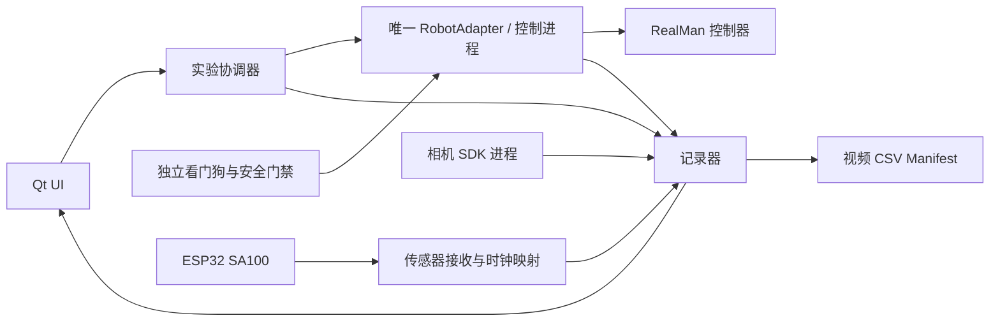

# Ubuntu 真机实验控制平台实施计划书

日期：2026-10-13。本文是待执行计划；本轮仅核对资料、编写文档和发布源码，没有在 Ubuntu 安装软件或驱动机械臂。

## 1. 目标和实施基线

在一台 Ubuntu 工作站上提供可视化工作台，完成：设备检查 → 相机/SA100 标定 → 机械臂只读连接 → 人工使能 → 实验准备 → 协调启动运动与采集 → 安全停止 → 数据质量检查 → 导出与回放。

用户补充确认：另一系统已经部署过真机库，并曾成功操作实物，只是暂时记不清型号和版本。因此首选恢复既有可用环境；不要覆盖、升级或删除旧SDK、ROS工作区及控制脚本。本文中的RM_API2是已核对的候选接口，旧系统若用其他版本，需要先按真实接口编写适配层。

全新环境的推荐基线是 Ubuntu 22.04 LTS x86_64、独立 Python 3.11、PlatformIO Core 6.2.0、现有固定 `espressif32@6.5.0` / Arduino-ESP32 2.0.14。仅在既有环境不满足需求时采用这一安装路径；若需要 MoveIt2 / ROS 工具，再接匹配发行版。不要为一个数据采集 UI 强制引入全部 ROS 依赖。

若目标系统是 Ubuntu 24.04，应采用匹配的 ROS 2 Jazzy 分支重新核验 RealMan 型号、控制器与依赖，不把 Humble 二进制包安装到 24.04。官方仓库存在 jazzy 分支，不代表已在本装置验收。

上机前必须填写的站点信息（保存在忽略的 `config/site.*`，不提交公网）：

| 信息 | 当前状态 / 决策用途 |
|---|---|
| RealMan 实际型号、自由度、控制器代际/固件版本 | 未确认；仿真 RM65-B 名称不能替代真实铭牌 |
| Ubuntu 版本、CPU 架构、GPU / 驱动 | 未确认；决定 SDK `.so` 和相机包兼容性 |
| 机械臂 IP、TCP/UDP 端口与网卡 | 现场读取；文档中的厂商示例地址不能当真实配置 |
| 末端夹具、摆长、质量、惯量、负载/重心、关节限位 | 待测；决定安全限值与动力学适配 |
| 相机型号、RGB流分辨率/帧率、快门、硬触发能力 | 未定，可能深度相机；不能把深度流时间戳代替 RGB 时间戳 |
| SA100 安装方向和外壳是否旋转 | 未确认；旋转时必须增加姿态测量/变换 |
| ESP32-S3 开发板原理图、USB桥、原生USB/JTAG接口 | N16R8 只说明模块存储规格，不足以确定引脚和USB接法 |
| 物理急停、安全回路、工作空间与人员职责 | 必须现场确认后才能执行真实运动 |

## 2. Ubuntu 环境配置

### 2.1 先盘点另一系统上已成功使用的环境

在原系统中先执行只读检查，激活当时成功运行真机脚本的环境；找不到环境时先查旧项目的README、启动脚本和venv/conda配置，不尝试启动旧的运动demo：

```bash
cat /etc/os-release
uname -m
command -v python python3 conda uv pio ros2
python -V
python -m pip show Robotic_Arm
ls /opt/ros
# 仅在旧ROS环境已source后执行查询，不launch机器人：
ros2 pkg prefix rm_driver
```

保留旧SDK包/版本、原Git commit、虚拟环境名、Python版本、成功运行的入口脚本、控制器版本记录和网络配置；网络地址/序列号/凭据只保存在私有站点档案。`pip show`查不到不代表未安装，也可能是另一个环境、厂商本地库或旧接口。先读取旧代码的import/API调用，再对照对应厂商文档，不将旧API1与RM_API2名称混用。

如果旧SDK只支持系统Python或其他版本，让它继续运行在原环境的独立robot service进程，通过本机IPC接新Python3.11 UI/采集服务。只有隔离副本通过只读与mock验证后，才考虑迁移；不得为安装UI把已可用真机环境破坏。ROS发行版同理，先识别再选择文档安装路径。

### 2.2 缺失环境才安装：系统与 Python 隔离

下列是未来在 Ubuntu 22.04 上执行的命令，不是本轮已执行记录。先备份工作目录、当前固件、配置与私人数据，再迁移；公开 Git 仓库不是私人实验数据备份。

```bash
sudo apt update
sudo apt install git curl build-essential pkg-config python3-venv pipx \
  libgl1 libglib2.0-0 libusb-1.0-0-dev v4l-utils ffmpeg
pipx ensurepath
# 重新登录终端，使 ~/.local/bin 在 PATH 中。
pipx install uv
uv python install 3.11
git clone https://github.com/Pan-cyb/CVPR_Real_device_test.git
cd CVPR_Real_device_test
uv venv --python 3.11 .venv
source .venv/bin/activate
python -m ensurepip --upgrade
python -m pip install -e ./real_device
python -m unittest discover -s real_device/tests -v
python -m real_device demo --output "runs/demo_$(date +%Y%m%d_%H%M%S)"
```

当前 Python 依赖是 numpy、opencv-python、pyserial，尚未完整锁版本。Ubuntu 首次验证后保存 `python -V`、`pip freeze`、系统/内核版本到私有实验 manifest，再形成专门 Linux 锁文件。不要直接假设 Windows Python 3.14 的依赖版本与 Linux 最佳组合相同。

现有 CLI 预览依赖图形桌面和 `cv2.imshow`，SSH 无显示环境先跑 unittest / demo / 离线分析。未来 PySide6 UI 的 OpenCV 包选择需统一：不要同时安装 `opencv-python` 与 `opencv-python-headless`；若改 headless，先消除 CLI 对 HighGUI 的依赖并修改依赖声明。

### 2.3 ESP32 构建、烧录、串口与调试

```bash
pipx install 'platformio==6.2.0'
pio --version
pio run -d real_device/firmware -e esp32-s3-n16r8
ls -l /dev/serial/by-id/
python -m serial.tools.list_ports -v
```

优先使用 `/dev/serial/by-id/...`，不要把容易变化的 `/dev/ttyUSB0` 写死。普通串口权限通过 `sudo usermod -aG dialout "$USER"` 设置并重新登录；必要时按 PlatformIO 官方 udev 文档安装匹配规则，检查原生 USB/JTAG 的权限。不要以 root 长期运行 UI，不使用 `chmod 777` 绕过权限。只有实际发现 ModemManager 抢占该端口时，才增加设备级忽略规则，不全局禁用不相关服务。

烧录与串口监控示例，执行前确认端口确实属于目标板：

```bash
export ESP_PORT=/dev/serial/by-id/REPLACE_WITH_VERIFIED_DEVICE
pio run -d real_device/firmware -e esp32-s3-n16r8 -t upload --upload-port "$ESP_PORT"
pio device monitor --port "$ESP_PORT" --baud 921600
# 退出 monitor 后再运行，两个程序不能同时占用串口：
python -m real_device probe --port "$ESP_PORT" --duration 3
```

当前固件 `Serial` 使用 UART0 / USB-UART 桥；原生 USB CDC 不是默认数据口。UART 日志/烧录不等于 JTAG 调试。VS Code + PlatformIO 可作为图形化固件工具；需要断点调试时，另行核验板卡原生 USB JTAG 接线、GPIO19/20占用、驱动与 udev，确认后才使用现有 board 描述中的 esp-builtin。断点暂停期间所有实时测量数据必须作废，不能一边调试暂停一边宣称采集有效。

先串口验收，后 Wi-Fi；Wi-Fi 凭据只写本机 `wifi_secrets.h`。UDP 同步与数据均要通过主机防火墙的限定网卡/端口，记录丢包、乱序、重启与实际频率，不依赖路由器是否“看起来很快”。

### 2.4 RGB / 深度相机

先用 `v4l2-ctl --list-devices` 确认设备，测试固定曝光、固定帧率和完整摆动范围内的铰点/杆尖可见性。当前 USB 路径可先验收：

```bash
python -m real_device capture --output runs/trial_001 --port "$ESP_PORT" \
  --camera 0 --fps 30 --width 640 --height 480 \
  --category free_fall --zero-deg REPLACE_WITH_CALIBRATED_NUMBER \
  --direction 1 --confirm-fixed-housing
```

上述零点是占位说明，必须换成 `probe` 在真实竖直位置测得的数值。该命令只采集，不发机器人指令。

若选 RealSense 或其他深度相机，再按具体型号安装厂商 SDK / udev、选择 RGB 曝光时间戳、记录 clock domain / frame counter / 分辨率 / 内参与畸变参数。设备时间到主机单调时间要单独拟合，映射质量不合格不能开始实验。相机延迟用同一次物理事件的视觉变化和传感器变化独立校准，保留估计不确定度；软件同时调用 start 不等于同时曝光。深度是可选辅助信息，不替代角度基准，也不自动消除透视误差。

## 3. RealMan 接口接入

### 3.1 官方来源与兼容性证据

2026-10-13 查验的官方来源：

- [RM_API2](https://github.com/RealManRobot/RM_API2)，快照 `9d75cc995f52095837dddca594531621be18cf7b`；Python 包 `Robotic_Arm`，官方说明 Python 3.9+，Linux x86 / ARM。
- [Python 接口源文件](https://github.com/RealManRobot/RM_API2/blob/9d75cc995f52095837dddca594531621be18cf7b/Python/Robotic_Arm/rm_robot_interface.py)。这些名称经源文件核对，不代表已连接本装置验证。
- [ros2_rm_robot Humble](https://github.com/RealManRobot/ros2_rm_robot/tree/c941b565e4f9174afa36561f143ef5fbbb744750)，README 指定 Ubuntu 22.04、ROS2 Humble、包 V1.7.0 / 控制器 1.7.3。是否适配现场控制器仍需确认。
- [ROS 2 Humble 安装](https://docs.ros.org/en/humble/Installation/Ubuntu-Install-Debs.html)；[PlatformIO udev](https://docs.platformio.org/en/latest/core/installation/udev-rules.html)。

先复用并记录另一系统已成功使用的SDK；确需新增RM_API2时才在隔离环境安装并冻结验证版本，不直接把研究脚本里的 import 路径当官方稳定 API。用独立网卡连接机械臂、固定本地网段；记录实际控制器版本、SDK版本、API返回码和断连行为。不要从 UI 同时建立多套运动连接。

### 3.2 适配器设计（尚未实现）

定义 `RobotAdapter`：`connect_readonly()`、`get_state()`、`arm(profile)`、`start_trial(plan)`、`request_stop(reason)`、`disconnect()`。UI / 策略只访问这个接口。`arm()` 是本平台通过检查后允许命令的状态转换，不假称是某一个未经核对的厂商“使能函数”。

| 平台职责 | 已核对的 RM_API2 接口 | 实施约束 |
|---|---|---|
| 创建连接/释放资源 | `rm_create_robot_arm` / `rm_delete_robot_arm` | 初始仅只读；销毁连接不是安全停止 |
| 查询型号/软件与当前状态 | `rm_get_arm_software_info` / `rm_get_current_arm_state` | 检查返回码、关节数量、数据年龄 |
| 实时状态推送 | `rm_set_realtime_push` / `rm_realtime_arm_state_call_back` | callback只收集入队，不在回调中跑模型或写视频 |
| 低速规划运动候选 | `rm_movej` | 参数单位、速度、blend/connect/block按实际SDK核对，先空载验收 |
| 流式关节透传候选 | `rm_movej_canfd` | 仅在确认周期、轨迹模式、失联行为后启用；函数名不代表PC需外接CAN线 |
| 运行停止/暂停/继续 | `rm_set_arm_stop` / `rm_set_arm_pause` / `rm_set_arm_continue` | 不是安全认证急停；continue不允许自动调用 |

先完成只读连接、状态和错误码测试，再实现无运动 mock，最后才是限速、限空间的真实运动。不要将 SDK 参数 `v` 的百分比与 m/s 混用；本平台内部使用 rad、m、s，边界转换明确记录。仿真的 `action * 0.45 m/s`、6 m/s²等参数不能直接用于实机。

### 3.3 ROS 可选路线

ROS 2 Humble 使用系统 Python 3.10 环境，不在 Python 3.11 UI venv 中随意安装/覆盖 rclpy。优先独立 ROS driver/bridge 进程，通过本机 IPC 给 UI / recorder；只允许一个控制所有者。MoveIt2 用于校验/规划，不自动成为高频倒立摆控制器。实际控制周期由 SDK、控制器、模型推理耗时与稳定性测量共同决定，不能以相机30 fps或传感器200 Hz直接推导。

## 4. UI 控制平台设计（尚未实现）

首版推荐本机 **PySide6 + pyqtgraph**，免浏览器服务暴露，适合单实验台。先固定依赖/Qt平台插件并做Linux显示测试。页面分为：

| 页面/区域 | 操作与显示 | 必须满足的行为 |
|---|---|---|
| 设备连接 | 机械臂只读连接、串口/UDP、相机选择，版本与数据年龄 | 自动发现不能自动运动；错误有可定位原因 |
| 标定 | SA100零点/方向、视觉标记与相机参数、外壳姿态 | 保存不可变 calibration ID，不在正式录制中偷偷改零点 |
| 实验设置 | free_fall / assisted / 后续robot_controlled，时长、命名、输出路径 | 模式、动作来源、控制profile可追溯 |
| 运行监视 | RGB、视觉/传感器角曲线、机器人状态、RTT/丢包/有效性 | 绘图降频，不影响采集；显示真实数据年龄 |
| 操作按钮 | 检查就绪、人工使能、准备采集、启动实验、停止、导出 | START须收到所有ready/ACK；重复点击幂等；停止始终可达 |
| 数据管理 | trial列表、回放、质量结果、CSV/NPZ/视频+manifest导出 | 不覆盖旧trial；导出只读快照；不把数据自动推GitHub |

结构：



当前 CLI 的 `cv2.imshow/waitKey`、采集状态机与记录器仍有耦合；先提炼可测试的服务接口，再接 Qt 信号/槽。设备 I/O、编码、SDK、推理均不能阻塞 GUI 线程。线程/进程间队列有上限和丢弃策略，停止路径不能排在视频写盘队列之后。

## 5. 协调启动、ESP32 会话控制与数据契约

现有 ESP32 v1 只有样本流和同步响应；“PC按r开始记录”并不控制传感器物理启动。UI需求需要新增协议，不能把待实现命令写成已有功能。

拟议 v2：`HELLO/STATUS/SYNC/ARM/START/STOP`，带协议版本、session_id、command_id、boot_id、请求时间、执行时间、ACK/错误码。命令重试幂等；旧会话/旧boot拒绝；START前必须ARM；STOP可重复。预采样允许用于就绪和同步，但写入正式trial的窗口由统一时钟界定。v1与v2能力协商，不能悄悄改变现有数据格式。

将实验状态设为 `DISCONNECTED → CONNECTED_READONLY → CALIBRATED → READY → ARMED → RECORDING → STOPPING → SAVED`，异常进入 `FAULT`；FAULT解除需人工复核，不自动回到RECORDING。

启动流程：检查全部设备和磁盘 → 固定校准版本 → 完成时钟同步 → 准备相机/记录器 → ESP ARM ACK → 机械臂计划检查/人工使能 → 协调器生成统一 t0 → 下发带会话的START与经批准的运动计划。记录请求/接收/实际执行时间，量化启动偏差；未实现硬触发时只能承诺测得的软件同步误差。任一路超时则取消启动并安全停止，不允许“机器人已动但记录器未开”。

新增机器人记录至少包括 `t_command_pc_ns, t_ack_pc_ns, t_state_pc_ns, timestamp_kind, command_id, measured_q, measured_dq, tcp_pose, target, control_mode, sdk_return_code, fault_flags`。若没有设备时间戳，标为host receive/poll代理并记录轮询区间，不伪造执行时间。记录设备/主机时钟模型和校准版本；SA100外壳旋转时基于同步姿态重建世界摆角，避免把来自同一RGB估计的姿态当独立真值。

统一manifest含代码commit、固件hash、SDK/系统版本、装置参数、相机配置、动作语义、校准ID、实验类别、start/stop原因、数据质量、文件校验和。写盘采用临时目录→完成检查→原子封存；异常保留partial与原因，不能写成成功。

停止流程区分两件事：记录窗口在6s/角阈值等规则处截断；机器人立即收到预先验收的安全停止/保持请求，等待状态确认；可另存短暂停止后telemetry用于证明停止完成，但不把它混入正式评估窗口。

## 6. 安全边界

**120°采集阈值、软件停止按钮、Wi-Fi心跳都不是物理急停。** 安全功能首先由机械臂控制器和现场硬件回路承担；在通信失效时，依赖同一条断开的TCP链路发送stop不足以构成安全策略。

上线前实施并验收：

1. 验证物理急停、控制器限速/限位/碰撞策略、失联策略、末端负载与固定；设定人员禁入区、摆杆缓冲/防脱落和现场操作人。急停后释放、掉电或重连均不得自行恢复轨迹。
2. 明确实机允许的关节范围、TCP包络、速度/加速度/jerk、力矩/碰撞阈值、摆角安全阈值和停止距离；这些数值目前为空，按厂商/机构现场验证填写，不从仿真照抄。
3. 后端独立门禁拒绝越界、非有限值、单位错误、过期状态、重复/旧会话、无控制权命令；看门狗覆盖UI退出、采集进程崩溃、相机/编码器失联、磁盘满、模型超时和SDK断连。
4. 各级停止优先级为物理急停/控制器故障 > 安全门禁停止 > 操作员停止 > 实验正常结束。保存触发原因和停止确认，不用“函数返回0”代替实际停稳判断。
5. `assisted_balance` 人手接触模式默认机器人禁止自主运动，只能在机械臂静止/经现场另行评估的人机协作模式采集；不能在手扶摆杆时直接启用自主控制策略。自由落体也需防止摆杆撞人或设备。
6. 真正RGB反馈控制尚未实现。验证用传感器不偷偷进入控制策略；若用于独立安全门禁要记录这个角色，并区分策略输入、验证真值与安全输入。

看门狗阈值、最大可接受同步误差、停止响应/距离都要形成量化验收表。起始阶段的100ms传感器stale、500ms相机stale只是现有采集软件参数，不能宣称足以保障机械臂安全。

## 7. 分阶段工作单与验收

| 阶段 | 工作 | 通过条件 / 证据 |
|---|---|---|
| M0 盘点与迁移恢复 | 找回已成功使用的SDK/脚本/环境，保留原配置；克隆、隔离新增采集依赖 | 原环境版本/入口有据可查且未被修改；25项测试在新隔离环境运行；两段demo解码帧数=CSV |
| M1 ESP32 | 构建/刷写、串口、标定、可选JTAG；再测UDP | 无运动条件连续采集，核对原始PWM频率/角度方向/有效率；拔线/重启数据作废；测传输负载与丢包 |
| M2 相机与同步 | RGB/深度SDK、标记、延迟/时钟校准 | 独立物理事件对齐，报告误差分布；曝光时间语义清晰，掉帧不被当作等间隔帧 |
| M3 RealMan只读 | 型号/版本、状态适配、mock接口 | 不发运动命令即可获得有效状态；错误码/失联/多控制者拒绝测试 |
| M4 UI离线 | Qt界面、会话控制、回放/导出 | fake设备完成ARM/START/STOP、重复点击、异常和文件一致性测试 |
| M5 安全运动 | 控制器安全配置、独立门禁、空载低速、小范围单轴 | 现场授权；测限位、UI/进程退出和通信中断下实际停止；物理急停可达 |
| M6 协调采集 | ESP v2 + UI协调器 + 相机 + 机器人 | 统一会话、start ACK与时间误差；6s/阈值/人工STOP；MP4/CSV/robot日志一一可追溯 |
| M7 真机研究 | 校准几何/动作、恢复目标模型、离线评估→低风险在线 | 统一仿真协议；按trial分集；提供重复实验和置信区间，人工辅助不混作自主成功 |

每阶段失败先保留证据，不跳到下一阶段运动。SDK和UI的代码实现仍按一个写入worker、主对话审核推进；必要的硬件控制独立核验在用户授权范围内开展，不由本文自动授权持续运动。

## 8. 交付物和优先顺序

先实现 M0–M3，并交付 Linux 环境清单、设备只读诊断报告、校准记录和mock接口。再做 Qt UI及ESP会话协议；安全门禁验收后才连接运动按钮。最后接策略与真机对比指标。

后续代码预期目录可以是 `real_device/pc/real_device/robot/`、`ui/`、`services/` 和配置示例；这些目录和API目前是设计，不应在文档里写成已经存在。无需先改动仿真世界模型，也不要在没有权重、动作定义和硬件安全验收时启动学习策略驱动机械臂。
